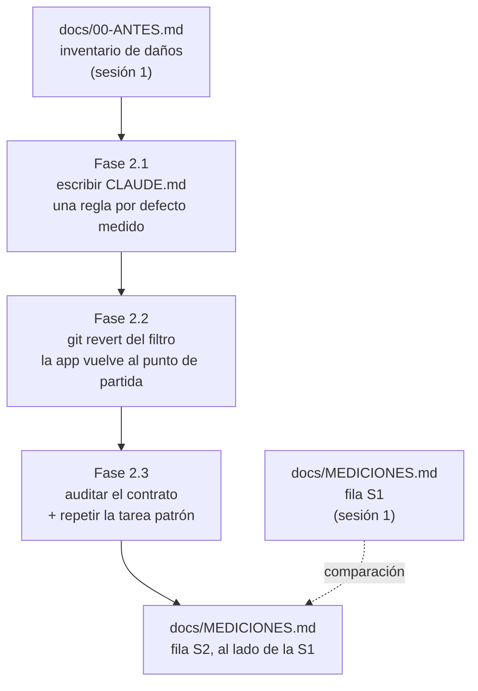

# Claude Code Ed. 5 — Sesión 2: Memoria y contexto, `CLAUDE.md` como contrato

## Este documento contiene la especificación completa de la sesión. Léelo completamente antes de ejecutar nada. No hagas suposiciones fuera de lo especificado.

**Prompts de la sesión (ejecutar en orden; versión completa y autocontenida de cada uno en `PROMPTS_sesion2.md`):**

0. "Ejecuta el Prompt 0 de `PROMPTS_sesion2.md`: verifica el terreno."
1. "Lee `Ed5_sesion2.md` completo y confírmame que entiendes el alcance. No ejecutes nada todavía."
2. "Ejecuta la Fase 2.1: escribe mi `CLAUDE.md` a partir del inventario de daños."
3. "Ejecuta la Fase 2.2: revierte la tarea patrón de la sesión 1 y deja la app como estaba."
4. "Ejecuta la Fase 2.3: audita el `CLAUDE.md` y repite la tarea patrón."
5. "Ejecuta el Prompt de cierre de `PROMPTS_sesion2.md`: bitácora y `CLAUDE.md` al día."

---

## Objetivo general

Al terminar, el alumno tiene en su repositorio un `CLAUDE.md` escrito por él,
donde cada regla apunta a un defecto que midió en la sesión 1, y la segunda
fila de `docs/MEDICIONES.md` llena con la misma tarea de la semana pasada
corrida con ese contrato puesto. Sabe leer la jerarquía de memoria que el
agente carga, sabe comprobar qué está viendo de verdad, y sabe auditar su
propio contrato para que no afirme cosas falsas.

## Objetivos específicos

* Que el alumno distinga lo que un `CLAUDE.md` **pide** de lo que un hook
  **impone**, y sepa por qué eso evita frustración en las sesiones siguientes.
* Que cada regla de su contrato tenga una fila del inventario detrás y un
  comando que la comprueba.
* Que sepa comprobar, con `/context all`, qué archivos de memoria está
  cargando el agente, y no suponerlo.
* Que tenga medida la segunda corrida de la tarea patrón, en las mismas
  condiciones que la primera.
* Que sepa que un contrato envejece, y que auditarlo es parte de tenerlo.

---

## Qué vas a construir, en palabras simples

La semana pasada contrataste a alguien muy rápido y no le dijiste cómo
trabajas. Hoy se lo dices por escrito.

Ese papel es el `CLAUDE.md`: un archivo de texto que el agente lee al empezar
cada conversación. No es configuración y no obliga a nada, es contexto: el
agente lo lee y trata de seguirlo. Lo que tiene que cumplirse pase lo que pase
no va ahí, va en un hook, y eso es la sesión 6.

Lo que escribas hoy no sale de una plantilla, sale de tu propio inventario de
daños. Cada regla responde a algo que tú mediste la semana pasada. Y al final
del día repites exactamente la misma tarea del viernes, con el contrato puesto,
para ver si el papel sirvió de algo.



## Glosario mínimo

| Término | En una línea |
|---|---|
| `CLAUDE.md` | Archivo de texto que el agente lee al empezar cada conversación y trata de seguir. |
| Contrato | La forma de usar el `CLAUDE.md` que enseña este curso: reglas comprobables, no descripción del proyecto. |
| Jerarquía de memoria | Las capas de archivos de memoria que el agente carga a la vez, de la política de la empresa hasta tu carpeta de trabajo. Se suman, no se reemplazan. |
| Memoria automática | Notas que el agente se escribe a sí mismo entre conversaciones, fuera de tu repositorio. Está activa por defecto. |
| `@import` | Línea que mete el contenido de otro archivo dentro del `CLAUDE.md`, como `@AGENTS.md`. |
| `.claude/rules/` | Carpeta de reglas que se cargan solo cuando el agente toca los archivos que la regla indica. |
| Compactación | Lo que hace el agente cuando la conversación ya no cabe: la resume y sigue con el resumen. |
| `/context` | Comando que muestra qué está ocupando la conversación, incluida la lista de archivos de memoria cargados. |
| Output style | Cambia cómo te responde el agente durante toda la sesión, no qué sabe de tu proyecto. |
| Hook | Instrucción que ejecuta la herramienta, no el modelo, así que se cumple siempre. Es la sesión 6. |
| `git revert` | Crea un commit nuevo que deshace lo que hizo otro commit, sin borrar el historial. |
| Tarea patrón | La misma tarea chica que se le pide al agente en las sesiones 1, 2 y 3 para poder comparar. |
| Línea base | Tu "antes": la primera medición de la tarea patrón, corrida **sin reglas**, que es el punto de comparación de todas las demás. Es la fila S1 de la tabla. Una fila sola no dice nada; dice algo al lado de la siguiente. |

---

## Antes de empezar: tareas humanas

1. **Actualizar Claude Code a 2.1.283 o superior** (5 min, sin costo). La Fase
   2.3 usa `/doctor prompt-audit`, que no existe en versiones anteriores.

   **Primero comprueba qué versión tienes, y hazlo donde vayas a trabajar.**
   Si usas la terminal y también la extensión del editor, pueden ser dos
   instalaciones distintas con versiones distintas:

   ```bash
   claude --version
   ```

   **Si está por debajo de 2.1.283**, actualiza con el comando propio:

   ```bash
   claude update
   ```

   Y si tu instalación es por npm y el anterior no la mueve:

   ```bash
   npm install -g @anthropic-ai/claude-code@latest
   ```

   Para saber cómo la tienes instalada: `npm ls -g --depth=0` la lista si
   vino por npm. Después de actualizar, **vuelve a correr `claude --version`**
   y reinicia la sesión.

   **Si no se puede actualizar**, la fase 2.3 se hace a mano y no se pierde: el
   prompt alternativo está escrito, con los cuatro criterios, y se anota en la
   bitácora que la auditoría fue manual.
2. **Tener a mano el `docs/00-ANTES.md` de la sesión 1** (1 min). Todo lo que
   se escribe hoy sale de ese archivo. Quien llegue sin inventario escribe las
   dos reglas mínimas que indica la Fase 2.1 y sigue.

## Estado de partida

La carpeta de la sesión trae cuatro archivos para el alumno: esta spec, los
prompts, `TAREA_PATRON.md` y `tokens.py`. Los dos últimos son **copias
idénticas** de las de la sesión 1, para que la carpeta funcione sola. Si alguna
vez se modifican, se modifican las dos: un enunciado distinto en cada copia
rompe la regla de las tres corridas. Se comprueba con
`diff curso-ed5/TAREA_PATRON.md curso-ed5/sesion2/TAREA_PATRON.md` → sin salida.

| Debe existir | Dónde | Lo usa la fase |
|---|---|---|
| El inventario de daños de la sesión 1 | `docs/00-ANTES.md`, sección INVENTARIO DE DAÑOS | 2.1 |
| La lista de decisiones que el agente tomó sin que nadie se las pidiera | `docs/00-ANTES.md` o `docs/BITACORA.md` | 2.1, 2.3 |
| La primera fila de la tabla de mediciones, llena | `docs/MEDICIONES.md`, fila "S1 · sin reglas" | 2.3 |
| El enunciado de la tarea patrón que se usó en la corrida 1, escrito al pie de la tabla | `docs/MEDICIONES.md` | 2.3 |
| Los dos enunciados de la tarea patrón, el original y el de repuesto | `doc_sesions/sesion2/TAREA_PATRON.md` §1, y copiados en el prompt de la línea base | 2.3, y la línea base del caso C |
| Un historial de git en uno de los cuatro casos de la Fase 2.2. **No se da por hecho que la tarea patrón esté commiteada aparte**: ver el hallazgo 10 | el historial del repositorio, `git log --oneline` | 2.2 |
| El repositorio sin cambios pendientes, en `<COMMIT_ANTERIOR>`, **si el historial está en el caso A** | `<RUTA_PROYECTO>` | 2.2 |
| **Ningún `CLAUDE.md` todavía**, ni en la raíz ni en `.claude/` | `<RUTA_PROYECTO>` | 2.1 |
| Claude Code 2.1.283 o superior | la máquina del alumno | 2.3 |

### Decisiones tomadas al preparar esta sesión

| # | Hallazgo | Resolución | Fase |
|---|---|---|---|
| 1 | `/doctor prompt-audit` existe y hace exactamente lo que pide el temario: busca instrucciones escritas para modelos anteriores, referencias a archivos o comandos que ya no existen, y archivos que se contradicen. Solo reporta: propone ediciones y no cambia nada hasta que se lo pidan. **Requiere 2.1.283 o superior** | Es el centro de la Fase 2.3, y la actualización pasa a ser tarea humana con un camino alternativo escrito | 2.3 |
| 2 | El audit corre a través de la Skill incorporada `/claude-api`. Si esa Skill está desactivada, el comando no está disponible | Fila en "Si algo falla" | 2.3 |
| 3 | Existe un segundo comando parecido, `/claude-api prompt-audit`, que audita prompts de aplicaciones construidas sobre la API. **No es el mismo** | Se nombran los dos en clase para no confundirlos | 2.3 |
| 4 | Además del `CLAUDE.md` hay **memoria automática**: notas que el agente se escribe a sí mismo fuera del repositorio, y está activa por defecto | Entra en la teoría de la jerarquía, y explica por qué el Prompt 0 de la sesión 1 exigía terreno limpio | 2.1 |
| 5 | El plan de producción pedía que la Fase 2.2 fuera compactación de contexto y output styles | Esos dos temas quedan como teoría, porque se entienden leyendo `/context` en pantalla y no producen artefacto. **La Fase 2.2 del lab es revertir el filtro**, que sí es condición para que la medición sirva | 2.2 |
| 6 | En la corrida de preparación, el prompt de la Fase 2.1 ya pedía que cada regla apuntara a un defecto medido, pero no pedía demostrarlo, y el archivo que salió tenía 50 líneas de las cuales solo 9 cumplían. El resto describía la arquitectura y el framework | El prompt de la 2.1 exige una tabla de trazabilidad regla por regla antes de escribir el archivo | 2.1 |
| 7 | En esa misma corrida, el material sugería `/init` al final del mismo prompt y sin prohibirle escribir, y la versión de `/init` fue la que sobrevivió | `/init` pasa a ser un paso aparte, posterior al archivo escrito, con prohibición explícita de escribir | 2.1 |
| 8 | Si en la sesión 1 el agente ya puso el estado del filtro en la URL por su cuenta, la regla de "Estado de la interfaz" le entrega la respuesta de la única columna que la tarea patrón mide | Se avisa en clase antes del lab: la comparación entre S1 y S2 va a depender sobre todo de las decisiones no pedidas y de los turnos | 2.3 |
| 9 | La versión instalada en la máquina de preparación al 2026-11-11 es **2.1.206**, por debajo del mínimo | Queda como bloqueo abierto para el docente, y es la primera fila de "Si algo falla" | 2.3 |
| 10 | **La sesión 1 no exige los commits que la Fase 2.2 necesita.** Sus prompts terminan con "commit propuesto: <mensaje>", o sea proponen el texto y no ejecutan el commit; la única instrucción de tocar git está en el prompt de cierre, que corre **después** de la 1.4; la verificación de la 1.4 sí pide `git log --oneline` con un commit por fase, pero se comprueba cuando el filtro ya está escrito y mezclado con la app; y el `.gitignore` nace en ese mismo prompt de cierre, así que quien commitea por fase lo hace sin él. En la corrida de preparación esto apareció como defecto extra del inventario: la app estaba sin seguimiento al auditarla, y hubo que commitearla a mano antes de la 1.4 | El Prompt 0 de esta sesión **clasifica el historial del alumno en cuatro casos** y la Fase 2.2 trae un camino para cada uno, y el caso sin commits se resuelve con una línea base nueva antes de la Fase 2.1. Aparte, queda pendiente corregir la sesión 1 para que los commits se hagan donde corresponde | 0, 2.2 |

| 11 | **La sesión 1 dejó dos datos en el aire y los dos se pueden recuperar.** Su material no nombraba `tokens.py`, así que la FACTURA quedó sin costo ni duración; y pedía las decisiones no pedidas en el chat sin mandar escribirlas en ningún archivo, así que se fueron al cerrar la conversación. Los dos son columnas que esta sesión necesita para comparar | Dos pasos de recuperación **antes del Prompt 1**, los dos condicionales. El primero corre `tokens.py`, identifica la conversación de la generación como la de más turnos y más salida, y actualiza la FACTURA de `docs/00-ANTES.md`. El segundo **vuelve al chat de la Fase 1.2** con el comando de reanudar, porque es el único que tiene la lista en contexto, y la escribe en `docs/BITACORA.md`. Si las conversaciones se borraron o se compactaron, se deja "sin medir" y se sigue | previa |

---

## Mapa de fases y dependencias

| Fase | Qué entrega (en una línea) | Depende de | Se verifica con |
|---|---|---|---|
| 2.1 | El `CLAUDE.md` del proyecto, con una regla por defecto medido y su tabla de trazabilidad | Prompt 0 | `wc -l CLAUDE.md`, y `/context all` muestra el archivo en Memory files |
| 2.2 | La app de vuelta en el estado anterior a la tarea patrón | 2.1, y el caso de historial del Prompt 0 | `git status` limpio y la tarea ya no está en pantalla |
| 2.3 | El informe de la auditoría y la fila S2 de `docs/MEDICIONES.md` | 2.2 | La fila S2 llena con los seis datos y el informe anotado en la bitácora |

## Convenciones transversales

* **Hoy sí se toca la app**, pero solo a través de la tarea patrón de la Fase
  2.3. Los defectos del inventario no se corrigen en el código: hoy entran al
  contrato como reglas.
* **Cada regla del `CLAUDE.md` apunta a una fila del inventario.** Si una línea
  no corresponde a ninguna, se borra.
* **Lo que todavía no es verdad no se escribe como si lo fuera.** Si hoy no hay
  pruebas, el contrato lo dice así.
* **La tarea patrón no se reescribe.** El enunciado de la corrida 2 es el mismo,
  palabra por palabra, que el de la corrida 1.
* **Cada fase, en conversación nueva.** La **2.3 son dos conversaciones**: una
  audita el contrato y otra corre la tarea. El corte es por medición, no por
  prolijidad: si la corrida arranca en el chat donde se acaba de discutir el
  `CLAUDE.md` línea por línea, llega con todo eso en contexto y la fila deja de
  ser comparable.
* **Cuando la spec dice "anota", el que anota es el alumno.** El agente no
  puede medir su propia conversación ni contar los turnos en que lo
  corrigieron.
* **Los comandos que empiezan con `/` los escribe el alumno en el chat.**
  `/doctor prompt-audit`, `/context all`, `/init` y `/memory` son comandos de
  Claude Code, no instrucciones que el agente pueda ejecutar por su cuenta. En
  los prompts, el agente trabaja **sobre la salida** de esos comandos, que ya
  está en el chat. Cada fase que usa uno dice de forma explícita quién lo
  escribe.
* **Un commit por fase**, salvo la 2.3, que lleva dos: uno de la auditoría y
  otro de la corrida.

---

# FASES

## Fase 2.1 — El `CLAUDE.md` que nace del inventario

**Prompt sugerido:** "Ejecuta la Fase 2.1 de `Ed5_sesion2.md`."

### Qué se construye

El contrato del proyecto: un archivo de menos de 40 líneas donde cada regla
responde a un defecto que el alumno midió la semana pasada, y cada una trae el
comando que permite comprobarla.

### Depende de

El Prompt 0, y el `docs/00-ANTES.md` de la sesión 1 con su inventario.

### Archivos

| Archivo | Rol |
|---|---|
| `CLAUDE.md` | El contrato del proyecto, en la raíz. Va al repositorio y lo ve el equipo. |
| `docs/00-ANTES.md` | Materia prima. **Se lee, no se modifica** en esta fase. |

### Reglas

* El archivo tiene **menos de 40 líneas** y solo estas secciones: qué es esto,
  comandos, reglas de arquitectura, valores ajustables, estado de la interfaz,
  y seguridad.
* **Una regla por cada defecto del inventario que sí apareció**, con el comando
  que la comprueba. Un defecto que el inventario marca como "no apareció" no
  lleva regla.
* Un defecto que apareció **en forma parcial** lleva la regla escrita contra la
  forma que apareció, citando el archivo y la línea del inventario, no contra
  la forma general del encargo.
* Los **defectos extra** del inventario, fuera de los cuatro de la lista,
  también llevan regla.
* **No se escribe lo que el agente deduce leyendo el proyecto**: ni el árbol de
  carpetas, ni la lista de dependencias, ni un resumen de la arquitectura, ni
  las particularidades del framework. Eso ya lo lee solo y ocupa contrato.
* **El agente muestra el borrador y su tabla de trazabilidad antes de escribir
  el archivo**, y espera a que el alumno diga qué entra y qué sale.
* **No se usa `/init` dentro de esta fase**, y el prompt se lo prohíbe al
  agente de forma explícita. La comparación con `/init` es un paso posterior:
  el alumno lo escribe él mismo, **con el `CLAUDE.md` ya commiteado**, porque
  `/init` puede escribir en el archivo y el commit es lo que permite deshacerlo
  con `git checkout -- CLAUDE.md`.
* **No se corrige ningún defecto en el código.**
* Quien llegue **sin inventario** escribe dos reglas mínimas —el acceso a datos
  vive en un solo sitio, y los valores ajustables viven en un solo archivo— y
  sigue a la fase siguiente, anotando en su bitácora por qué su tabla va a
  comparar menos cosas.

### Cómo verificar al terminar

1. `wc -l CLAUDE.md` → menos de 40.
2. Cada regla del archivo aparece en la tabla de trazabilidad con su fila del
   inventario y su comando de comprobación. Una regla sin fila sobra.
3. Ningún defecto marcado como "no apareció" tiene regla.
4. El archivo no afirma nada que hoy sea falso. En particular, no dice que haya
   pruebas si no las hay.
5. `/context all` → el `CLAUDE.md` aparece en la lista **Memory files**. Lo que
   no aparece ahí, el agente no lo está viendo.
6. `git status` no muestra cambios en archivos de la app.

---

## Fase 2.2 — Volver al punto de partida

**Prompt sugerido:** "Ejecuta la Fase 2.2 de `Ed5_sesion2.md`."

### Qué se construye

Nada nuevo. Se deshace el filtro que el agente escribió en la sesión 1, para
que la corrida de hoy parta del mismo código que la de la semana pasada.

### Depende de

La Fase 2.1, y del caso de historial que el Prompt 0 haya clasificado.

### Archivos

| Archivo | Rol |
|---|---|
| Los que tocó el commit de la tarea patrón | Vuelven al estado anterior. El agente los identifica con `git show --stat`. |
| `.gitignore` | **Solo en el caso C.** Si no existe, se crea antes del primer commit, para no llevarse `node_modules` al repositorio. |

### Reglas

* Se revierte con **git**, no borrando archivos a mano: `git log --oneline`
  para encontrar el commit del filtro y `git revert <commit>` para deshacerlo.
  **El historial no se reescribe y no se usa `git reset --hard`**: el commit de
  la tarea patrón tiene que seguir existiendo, porque la sesión 3 vuelve a
  revertirlo.
* **El `/rewind` no se usa hoy**: llega en la sesión 6.
* **El camino depende del caso que clasificó el Prompt 0**, porque la sesión 1
  no garantiza que la tarea patrón esté commiteada aparte (hallazgo 10):

  | Caso | Qué hay en el historial | Qué hace la fase |
  |---|---|---|
  | **A** | un commit con la app y otro con la tarea patrón | revierte el de la tarea |
  | **B** | un commit con la app, la tarea sin commitear | commitea la tarea aislada y después la revierte |
  | **C** | ningún commit, o uno solo con todo mezclado | corre una **línea base nueva antes de la Fase 2.1**, que lo deja en caso A |
  | **D** | el commit de la tarea trae otras cosas mezcladas | revierte igual, y anota en la bitácora qué más volvió atrás |

* **El criterio es uno solo: si el commit de la tarea patrón se puede revertir
  o no.** No importa si la tarea se hizo ni si la fila S1 tiene datos.

  | ¿Se puede revertir? | Qué hace | Qué pasa con la fila S1 |
  |---|---|---|
  | **Sí** | revierte y en la 2.3 **repite el mismo enunciado que revirtió** | **se conserva** |
  | **No** | corre una línea base nueva antes de la Fase 2.1 | **se reemplaza** por la de hoy |

* **No se separa código para rescatar un commit mezclado.** Es laborioso, deja
  una reconstrucción que hay que explicar al pie de la tabla, y la línea base
  nueva sale exacta en 15 minutos. Decisión del 2026-11-11.
* **La línea base nueva se corre antes de escribir el `CLAUDE.md`.** Si se
  corre después, deja de ser una corrida sin reglas y no mide nada. Son tres
  pasos: commitear el punto de partida con su `.gitignore`, correr la tarea con
  el enunciado que a la app le falte, y commitear esa tarea aislada mientras se
  llena la fila S1. Al pie de la tabla queda el enunciado usado, entre comillas
  y completo.
* **Hay tres enunciados, y se usa el primero que la app no tenga hecho**: el
  filtro por categoría, la paginación de 6 por página, y el orden por precio.
  Si la app ya trae las tres cosas, se avisa al docente y queda anotado.
* **El enunciado que se use es el de todas las corridas del alumno**, hoy y en
  la sesión 3. Si revirtió, repite el que revirtió. Si corrió una línea base
  nueva, el nuevo pasa a ser el suyo. **No se mezclan.**
* **Esa corrida le suma unos 15 minutos al laboratorio**, y es lo primero que
  puede quedar para casa si el reloj aprieta.
* **No se arregla nada de paso.** La app tiene que quedar como estaba, defectos
  del inventario incluidos.
* `git status` tiene que quedar limpio antes de pasar a la 2.3.

### Cómo verificar al terminar

1. `git log --oneline -3` → el commit de revert aparece arriba, y el commit de
   la tarea patrón sigue existiendo debajo.
2. `git status --short` → sin salida.
3. `npm run dev` y el catálogo en el navegador → el filtro ya no está. Si sigue
   apareciendo, es caché del navegador: recargar sin caché antes de concluir
   que el revert falló.
4. El `CLAUDE.md` de la fase 2.1 sigue en su lugar y sin cambios.
5. En el caso C, la fila S1 dice con qué enunciado se midió, y al pie de la
   tabla está ese enunciado entre comillas y completo.

---

## Fase 2.3 — La auditoría y la segunda corrida

**Prompt sugerido:** "Ejecuta la Fase 2.3 de `Ed5_sesion2.md`."

### Qué se construye

Dos cosas. Primero el informe de la auditoría del contrato que el alumno acaba
de escribir. Después la segunda fila de la tabla de mediciones, con la misma
tarea de la sesión 1 corrida con el contrato puesto.

### Depende de

La Fase 2.2, con el repositorio limpio y el filtro revertido.

### Archivos

| Archivo | Rol |
|---|---|
| `CLAUDE.md` | Lo que se audita. Las correcciones las acepta el alumno, una por una. |
| `docs/MEDICIONES.md` | Recibe la fila "S2 · con `CLAUDE.md`". Las otras filas no se tocan. |
| `docs/BITACORA.md` | Recibe cuántos hallazgos tuvo la auditoría y cuántos se aceptaron. |

### Reglas

* **Paso 1, la auditoría.** El alumno escribe `/doctor prompt-audit` en el
  chat y lee el informe; el agente trabaja después sobre esa salida. El comando
  solo reporta: las ediciones las decide el alumno, hallazgo por hallazgo. Se
  anota cuántos hubo, cuántos se aceptaron, y si la auditoría fue con el
  comando o a mano.
* **El audit no comprueba si una regla afirma algo falso**, y eso es
  justamente la lección de la sesión. Por eso el prompt le pide además al
  agente ejecutar el comando de verificación que cada regla trae escrito y
  decir qué devolvió.
* **Sin 2.1.283 la fase se hace igual, a mano.** El prompt alternativo le pide
  al agente buscar cuatro cosas: instrucciones escritas para modelos que ya no
  existen, referencias a archivos o comandos que no existen, reglas que se
  contradicen entre sí, y reglas que afirman algo falso.
* **Paso 2, la corrida.** Conversación **nueva**, y el enunciado **idéntico** al
  de la corrida 1, copiado del pie de la tabla de mediciones. No se cambia ni
  una palabra: si hoy se explica mejor la tarea, la comparación mide la prosa
  del alumno y no su contrato.
* **Quien usó el enunciado de repuesto en la corrida 1 usa el de repuesto hoy.**
  El enunciado de la corrida 1 es el de las tres corridas.
* **Se verifican los cinco pasos sin abrir ningún archivo**, igual que en la
  sesión 1, y se mira la barra de direcciones para saber dónde quedó el estado.
* **El alumno mide y dicta** el resultado, los turnos de corrección, el costo y
  la duración. El agente pone dónde quedó el estado del filtro y en qué
  archivo. Las decisiones no pedidas se le piden al cerrar la conversación.
* **No se cambia el comportamiento del filtro para que la tabla luzca mejor.**
* **No se estima ningún dato.** Lo que no se midió dice "sin medir".

### Cómo verificar al terminar

1. La bitácora tiene el número de hallazgos de la auditoría y cuántos se
   aceptaron.
2. `docs/MEDICIONES.md` → la fila "S2 · con `CLAUDE.md`" está llena y las otras
   dos siguen como estaban.
3. Los cinco pasos de verificación de la tarea patrón pasan, o queda anotado
   cuál no pasó.
4. La fila S2 **difiere de la S1 en al menos un dato**. Si sale idéntica, se
   anota así y se escribe en la bitácora qué dice el contrato sobre lo que esta
   tarea mide: casi siempre la respuesta es que no dice nada.

---

## Si algo falla

| Síntoma | Causa más probable | Qué hacer |
|---|---|---|
| `Unknown command` al correr `/doctor prompt-audit` | versión anterior a 2.1.283 | `claude --version` y actualizar, o hacer la auditoría a mano con los tres criterios de la Fase 2.3 |
| El audit dice que no está disponible | la Skill incorporada `/claude-api` está desactivada | activarla, o auditar a mano |
| El `CLAUDE.md` no aparece en `/context all` → **Memory files** | está en una carpeta que no se carga, o es de una subcarpeta, y esas cargan a demanda | revisar la jerarquía de memoria; `/memory` lo abre para editar |
| El agente ignora una regla que sí está cargada | la regla es vaga, o hay dos reglas que se contradicen | hacerla verificable con su comando y correr el audit. Si **tiene** que cumplirse, es un hook y eso es la sesión 6 |
| `git revert` dice `error: commit ... is a merge` | el commit de la tarea patrón no quedó aislado | `git revert -m 1 <commit>`, y anotarlo en la bitácora |
| `git log --oneline` no muestra ningún commit del alumno, o muestra uno solo con todo adentro | la sesión 1 nunca pidió commitear: es el hallazgo 10 | caso C: correr la línea base nueva antes de la Fase 2.1, con el enunciado que la app no tenga hecho, y commitearla aislada |
| El agente dice que no puede distinguir qué código era de la tarea patrón | la tarea editó los mismos archivos que creó la app, y sin commits no hay frontera | no insistir: pasarse a la otra salida del caso C, la línea base nueva, que se corre antes de la Fase 2.1 |
| La línea base nueva salió sospechosamente buena, o en cero turnos | se corrió **después** de escribir el `CLAUDE.md`, así que no es una corrida sin reglas | esa corrida no sirve de línea base. Anotarla como S2, revertir, y correr la S1 no se puede ya: queda una sola fila y se dice así |
| La app ya tiene hechos los **dos** enunciados de `TAREA_PATRON.md` §1 | la tarea patrón de la sesión 1 fue una, y el agente agregó la otra por su cuenta en la fase 1.2 | no inventar un tercer enunciado. Avisar al docente: ese alumno compara por turnos y decisiones no pedidas sobre una tarea que el docente le dé en clase, y queda anotado |
| `git add` se lleva `node_modules` o un archivo `.env` | en el caso C todavía no hay `.gitignore`: en la sesión 1 nace en el prompt de cierre, después de la 1.4 | crear el `.gitignore` **antes** del primer commit, como indica el paso 1 de la línea base nueva |
| El filtro sigue en pantalla después del revert | caché del navegador | recargar sin caché; `git status` y `git log` dicen la verdad, la pantalla no |
| La app "ya tenía" el filtro al empezar la corrida 2 | no se revirtió el commit de la sesión 1 | volver a la Fase 2.2, `git log --oneline` y `git revert` |
| La fila S2 sale idéntica a la S1 | el `CLAUDE.md` no dice nada sobre lo que la tarea mide | comprobar si incluye la regla del estado de los filtros en la URL. Si ya la incluía y aun así empató, es el hallazgo 8 de esta spec: comparar por decisiones no pedidas y turnos |
| La app salió sospechosamente bien también hoy | memoria global propia, o memoria automática acumulada | no es un fallo, es la jerarquía de memoria funcionando. Anotarlo en la bitácora |
| Al alumno le sobró tiempo | — | que mueva una regla larga a `.claude/rules/` con `paths:` y compruebe con `/context` que el arranque pesa menos |

## Restricciones de la sesión

* **No se tocan costos, modelos ni effort**: eso es la sesión 3.
* **No se escribe ninguna Skill ni se conecta MCP**: sesión 4.
* **No se crean subagentes**: sesión 5.
* **No se escribe ninguna prueba ni ningún hook**: sesión 6.
* **No se corrigen los defectos del inventario en el código.** Hoy solo entran
  al contrato como reglas.
* **No se usa `/rewind`**: llega en la sesión 6. Hoy se revierte con git.
* **Ninguna cifra de mejora que nadie midió.** Si la fila S2 empata con la S1,
  se escribe que empató.

## Entregables

1. `CLAUDE.md` en la raíz del proyecto, de menos de 40 líneas, con su tabla de
   trazabilidad anotada en la bitácora.
2. El commit de revert de la tarea patrón de la sesión 1.
3. La fila "S2 · con `CLAUDE.md`" de `docs/MEDICIONES.md`, completa.
4. La entrada de la sesión 2 en `docs/BITACORA.md`, con el resultado de la
   auditoría.
5. Un commit por fase —dos en la 2.3, auditoría y corrida— y todo subido al
   repositorio.

## Producto de la sesión

El alumno se lleva su contrato escrito y auditado, y la segunda fila de su
tabla de mediciones al lado de la primera.

## Criterios de aceptación

* `CLAUDE.md` existe en la raíz y tiene menos de 40 líneas.
* Cada regla del archivo tiene una fila del inventario detrás y un comando que
  la comprueba.
* Ningún defecto marcado como "no apareció" en el inventario tiene regla.
* El `CLAUDE.md` no afirma nada que hoy sea falso.
* El `CLAUDE.md` aparece en `/context all` → Memory files.
* El commit de la tarea patrón de la sesión 1 está revertido y `git status`
  quedó limpio antes de la corrida 2.
* La corrida 2 usó el mismo enunciado que la corrida 1, palabra por palabra, o
  quedó escrito por qué esa comparación no es posible.
* La fila S2 está completa, con los seis datos, y ninguno estimado.
* La bitácora dice cuántos hallazgos tuvo la auditoría y cuántos se aceptaron.

## Registro de cambios

**2026-11-11 — versión 1.** Primera versión de la spec. El contenido técnico
viene de la preparación de la presentación, verificada contra la documentación
oficial el 2026-11-08, y de la corrida de preparación del 2026-11-09. Dos
cambios respecto de lo que se corrió ese día, los dos en la Fase 2.1: el
prompt exige ahora una tabla de trazabilidad regla por regla antes de escribir
el archivo, y `/init` pasó a ser un paso aparte con prohibición de escribir.
Los motivos están en los hallazgos 6 y 7. La Fase 2.2 del lab es revertir el
filtro, no compactación de contexto como pedía el plan de producción: el
motivo está en el hallazgo 5.

**2026-11-11 — versión 1.1.** Se verificó si la sesión 1 exige los commits que
la Fase 2.2 necesita, y **no los exige**: el detalle está en el hallazgo 10. A
partir de eso, el Prompt 0 clasifica el historial del alumno en cuatro casos y
la Fase 2.2 trae un camino para cada uno. "Si algo falla" gana seis filas.
Queda pendiente corregir la sesión 1 para que los commits se hagan donde
corresponde y el `.gitignore` nazca antes del primer commit, no en el prompt de
cierre.

**2026-11-11 — versión 1.4.** Simplificada la salida del caso C, por decisión
del docente tras el ensayo. **Se descarta separar código para rescatar un
commit mezclado**: el criterio pasa a ser uno solo, si el commit de la tarea
patrón se puede revertir o no. Si se puede, se conservan los datos de la
sesión 1 y en la 2.3 se repite **el mismo enunciado que se revirtió**. Si no se
puede, se corre una línea base nueva antes de la Fase 2.1 y los datos viejos se
reemplazan. Y se agrega un **tercer enunciado, el orden por precio**, para el
alumno cuya app ya trae el filtro y la paginación hechos; si trae las tres
cosas, avisa al docente.

**Pendiente en el material maestro.** El tercer enunciado está escrito en
`PROMPTS_sesion2.md`, dentro del paso de la línea base. `TAREA_PATRON.md`
sigue trayendo dos: hay que agregarle el tercero cuando se actualice el
maestro, y propagarlo a las copias de las carpetas de sesión.

**2026-11-11 — versión 1.2.** Tres correcciones de claridad para el alumno. La
primera es un error de fondo: en tres lugares el material le pedía **al agente**
correr `/context all`, `/init` y `/doctor prompt-audit`, y esos comandos los
escribe el alumno en el chat. Ahora cada paso dice quién hace qué, el agente
trabaja sobre la salida que ya está en el chat, y queda como convención
transversal. La segunda: el paso de `/init` exige tener el `CLAUDE.md`
commiteado antes, porque `/init` puede escribir en él, y trae los comandos para
ver qué escribió y deshacerlo. La tercera: la auditoría sin `/doctor
prompt-audit` pasó de una nota al pie a su propio prompt completo, con cuatro
criterios. Aparte, la carpeta de la sesión pasó a traer copias de
`TAREA_PATRON.md` y `tokens.py` para funcionar sola, y los dos enunciados de la
tarea patrón quedaron escritos dentro del prompt de la línea base, con la tabla
que dice cuál le toca a cada alumno.

**2026-11-11 — versión 1.3.** Salida del ensayo de la sesión 1 corrido sobre el
material que tienen los alumnos (ver `ENSAYO_2.md`). Se agregaron **dos pasos
de recuperación antes del Prompt 1**, los dos condicionales y los dos
explicados en el hallazgo 11: recuperar el costo y la duración de la generación
con `tokens.py`, y recuperar la lista de decisiones no pedidas volviendo al
chat de la Fase 1.2. El Prompt 0 gana una comprobación, la 4, que mira qué
datos de la FACTURA están vacíos. El orden es: primero el costo, después las
decisiones.

**Bloqueos abiertos.** La máquina de preparación tiene Claude Code 2.1.206 y
la Fase 2.3 necesita 2.1.283. Y la sesión 1 sigue sin pedir los commits por
fase: en el ensayo, el repositorio quedó con **un solo commit** con las cuatro
fases dentro, así que **todos los alumnos llegan en el caso C**, con el filtro
ya hecho o no.

**Nota de redacción.** El paso de recuperar las decisiones **no nombra ningún
comando**: el alumno abre la conversación de la Fase 1.2 en su historial y
escribe en ella, que sigue el hilo con todo su contexto. Se escribió primero
con comandos de reanudar y se quitaron, porque sobraban y eran lo único del
material sin ejecutar detrás.
