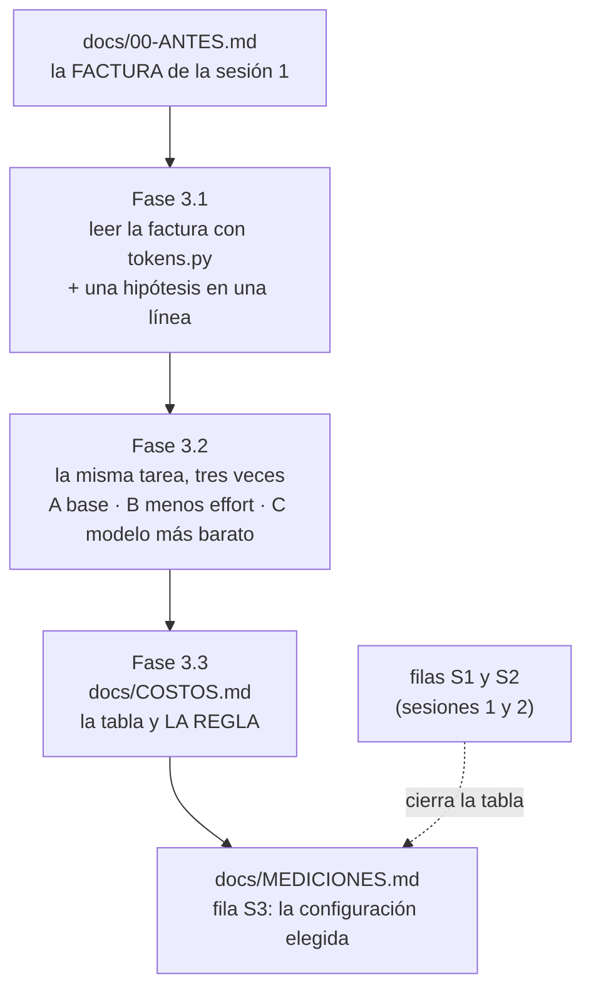

# Claude Code Ed. 5 — Sesión 3: Costos medidos, modelo, effort y caché

## Este documento contiene la especificación completa de la sesión. Léelo completamente antes de ejecutar nada. No hagas suposiciones fuera de lo especificado.

**Prompts de la sesión (ejecutar en orden; versión completa y autocontenida de cada uno en `PROMPTS_sesion3.md`):**

0. "Ejecuta el Prompt 0 de `PROMPTS_sesion3.md`: verifica el terreno."
1. "Lee `Ed5_sesion3.md` completo y confírmame que entiendes el alcance. No ejecutes nada todavía."
2. "Ejecuta la Fase 3.1: lee mi factura de la sesión 1 y ayúdame a escribir mi hipótesis."
3. "Ejecuta la Fase 3.2: la tarea patrón en tres configuraciones."
4. "Ejecuta la Fase 3.3: escribe mi `docs/COSTOS.md` con la regla de elección."
5. "Ejecuta el Prompt de cierre de `PROMPTS_sesion3.md`: bitácora y tabla al día."

---

## Objetivo general

Al terminar, el alumno tiene un `docs/COSTOS.md` propio donde la misma tarea
aparece corrida tres veces con tres configuraciones distintas de modelo y
effort, cada una con su costo en dólares, y una frase escrita por él que dice
para qué tarea usa cada configuración. Y tiene la tercera fila de
`docs/MEDICIONES.md`, con lo que cierra la tabla de tres filas del curso.

## Objetivos específicos

* Que el alumno sepa de dónde sale el dólar que ve en pantalla, y que entienda
  que con un plan de Claude ese número es una estimación a tarifa de lista, no
  una factura.
* Que sepa leer las tres cifras que explican el costo de una conversación:
  entrada nueva, lectura de caché y salida.
* Que sepa qué rompe la caché y qué no, y por qué el primer turno después de
  una pausa larga es el caro.
* Que tenga medido, con sus propios números, cuánto le paga bajar el effort y
  cuánto le paga cambiar de modelo en **su** tarea.
* Que salga con una regla de elección escrita por él, no con una tabla copiada.
* Que vea **cómo se movió el costo a lo largo del curso**, leyendo la columna de
  costo de sus tres filas: lo que costó la tarea sin reglas, con el contrato
  puesto, y con la configuración que eligió. Es la otra comparación de la
  sesión, y no es la de las tres corridas de hoy.

---

## Qué vas a construir, en palabras simples

Hasta hoy el costo era una impresión: "esto parece caro". Hoy se vuelve una
tabla con dólares.

La idea que gobierna la sesión es que **una conversación con un agente no se
paga por mensaje, se paga por lo que se reenvía en cada turno**. Cada vez que
le escribes algo, el agente vuelve a recibir toda la conversación anterior, no
solo tu última frase. Por eso el precio no depende de lo corto que escribas
sino de cuánto contexto arrastras y de a qué precio se te cobra ese arrastre.

La caché es el descuento que se aplica a lo que se reenvía sin cambios. Cuando
funciona, ese arrastre cuesta una fracción. Cuando se rompe, se paga entero.

Y después se mide. La misma tarea de las dos sesiones anteriores, tres veces,
cambiando una sola cosa cada vez: primero tu configuración actual, después el
effort más abajo, después un modelo más barato. Tres números, y la decisión de
cuál usar la tomas tú.



## Glosario mínimo

| Término | En una línea |
|---|---|
| Token | El pedazo en que se corta el texto para cobrarlo. Un token es más o menos tres cuartos de una palabra. |
| Entrada | Lo que el agente recibe en un turno: tu mensaje más toda la conversación anterior más tus archivos de memoria. |
| Salida | Lo que el agente escribe. Cuesta bastante más que la entrada. |
| Caché de prompt | El descuento que se aplica a la parte de la entrada que se reenvía **sin cambios** respecto del turno anterior. |
| Escritura de caché | Lo que cuesta guardar ese contexto la primera vez. Cuesta **más** que la entrada normal, y se paga una sola vez. |
| Lectura de caché | Lo que cuesta reenviar ese contexto ya guardado. Cuesta una fracción de la entrada. |
| TTL de la caché | Cuánto dura guardado antes de caducar. Si caduca, el siguiente turno vuelve a pagar la escritura. |
| Effort | Cuánto se le permite al modelo "pensar" antes de responder. Más effort es más calidad y más salida, y la salida es lo caro. |
| Tarifa de lista | El precio público por millón de tokens. Es con lo que se calcula el número que ves, aunque pagues con un plan. |
| Costo por tarea terminada | Lo que costó **acabar** algo, sumando los turnos de corrección. Es la única medida que sirve para decidir. |
| `/usage` | La pantalla de Claude Code que muestra el gasto de la sesión. `/cost` es su alias. |
| `tokens.py` | La herramienta del curso que lee las conversaciones guardadas en el disco y las convierte a dólares equivalentes. |

---

## Antes de empezar: tareas humanas

1. **Actualizar Claude Code a 2.1.283 o superior** (5 min, sin costo), si no se
   hizo en la sesión 2. Esa versión cubre todo lo que esta sesión necesita: la
   línea de caché de `/usage` pide 2.1.251, el reinicio de los totales con
   `/clear` pide 2.1.211, y fijar el reloj de la caché a mano pide 2.1.242.

   **Comprueba la versión donde vayas a trabajar**, porque la terminal y la
   extensión del editor pueden ser dos instalaciones distintas:

   ```bash
   claude --version
   ```

   Si está por debajo, actualiza con el comando propio y, si tu instalación
   vino por npm y ése no la mueve, con npm:

   ```bash
   claude update
   ```

   ```bash
   npm install -g @anthropic-ai/claude-code@latest
   ```

   Después vuelve a correr `claude --version` y reinicia la sesión.
2. **Tener hecha la medición de la sesión 2** (fases 2.2 y 2.3 de
   `PROMPTS_sesion2.md`). Por la decisión del hallazgo 1, ese laboratorio se
   corre en la clase de esta sesión, así que al llegar al laboratorio de la 3
   la fila S2 ya tiene que estar llena. Quien llegue sin ella hace la sesión
   igual: su comparación será su línea base contra la S3, y lo anota.

> **Para el docente, antes de dar la clase:** volver a consultar la tabla de
> precios y la fecha de §"Las tarifas" de este documento. Un número viejo en la
> sesión sobre costos destruye la credibilidad de las otras siete.

## Estado de partida

| Debe existir | Dónde | Lo usa la fase |
|---|---|---|
| La FACTURA de la sesión 1 | `docs/00-ANTES.md`, sección FACTURA | 3.1 |
| Las conversaciones guardadas del proyecto, que es lo que lee `tokens.py` | la carpeta de proyectos de Claude Code en la máquina del alumno | 3.1, 3.2 |
| La fila "S1 · sin reglas" llena | `docs/MEDICIONES.md` | 3.2, 3.3 |
| La fila "S2 · con `CLAUDE.md`" llena, **o la constancia de que falta** | `docs/MEDICIONES.md` | 3.2, 3.3 |
| El enunciado de la tarea patrón, al pie de la tabla | `docs/MEDICIONES.md` | 3.2 |
| El `CLAUDE.md` del proyecto, escrito y auditado en la sesión 2 | raíz de `<RUTA_PROYECTO>` | 3.2 |
| El commit de la tarea patrón, aislado y reversible | el historial, `git log --oneline` | 3.2 |
| El repositorio sin cambios pendientes, en `<COMMIT_ANTERIOR>` | `<RUTA_PROYECTO>` | 3.2 |
| Claude Code 2.1.283 o superior | la máquina del alumno | toda la sesión |

La carpeta de la sesión trae cuatro archivos para el alumno: esta spec, los
prompts, `TAREA_PATRON.md` y `tokens.py`. Los dos últimos son **copias
idénticas** de las de las sesiones 1 y 2, para que la carpeta funcione sola. Si
se modifican, se modifican todas: se comprueba con `diff` y tiene que salir sin
diferencias.

### Decisiones tomadas al preparar esta sesión

| # | Hallazgo | Resolución | Fase |
|---|---|---|---|
| 1 | **El laboratorio no entra en la misma clase que la teoría de esta sesión**, sobre todo porque la sesión llega con la medición de la sesión 2 pendiente | **El laboratorio de esta sesión se corre aparte de su clase de teoría.** La clase lleva la teoría y el laboratorio pendiente de la sesión 2; el de la 3 se corre cuando el docente lo programe, igual que pasó con el de la 2. Aparte, se recorta el bloque 05, que la propia presentación nombra como primero en caerse | toda |
| 2 | **El instrumento de medición cambiaba entre sesiones.** Las sesiones 1 y 2 miden el costo con `tokens.py`; la presentación de esta medía con `/usage`. Tres filas de una misma tabla con dos instrumentos distintos no se comparan | **Un solo instrumento para la tabla: `tokens.py`**, también en las tres corridas de esta sesión, y se anotan **tokens y dólares**, no solo dólares, porque los precios cambian y los tokens no. `/usage` se queda como pantalla de clase, para lo único que la herramienta no puede decir: si la caché está caliente ahora. Se mira, no se copia a la tabla | 3.1, 3.2 |
| 3 | La presentación dice que se anotan **seis** datos y `TAREA_PATRON.md` §3 dice **siete** | Son siete. El que falta es **decisiones no pedidas**, que es justamente el que en la corrida de preparación no empató. Se pide en las tres corridas: un modelo más barato puede decidir más cosas por su cuenta, y eso es un costo que no aparece en dólares | 3.2 |
| 4 | **`/cost` es un alias de `/usage`.** El comando que el alumno localizó en la sesión 1 sigue funcionando, pero la pantalla que hay que leer se llama `/usage` | Se nombran los dos para evitar la pregunta en clase | 3.1 |
| 5 | **Cambiar el effort ya no invalida la caché** en los modelos de la generación 5.5 y en Fable 5.1 o posterior, con clave de API o plan de Claude. En los demás sí, y Claude Code avisa antes | Hace que la corrida B salga barata, y va dicho con asterisco: en un modelo más viejo esa corrida cuesta más | 3.2 |
| 6 | **Editar el `CLAUDE.md` a mitad de sesión no rompe la caché, porque tampoco se aplica** hasta el siguiente `/clear`, `/compact` o reinicio | Cierra un cabo suelto de la sesión 2, y explica por qué las corridas tienen que empezar en conversación nueva | 3.2 |
| 7 | **El dólar que muestra Claude Code lo calcula la máquina del alumno**, contando tokens a tarifa de lista. Con un plan de Claude no se factura por token: se consume cuota | Es una lámina obligatoria. Sin ella, medio grupo cree que le están cobrando | 3.1 |
| 8 | Un prompt vago sí sale caro, pero **no por sus tokens**: por los turnos de corrección que provoca | El costo se mide **por tarea terminada**, y eso es lo que mide la columna de turnos | 3.1, 3.3 |
| 9 | En la corrida de preparación, la mayor parte del consumo entró **por lectura de caché**, y leerlo costó una fracción de lo que habría costado como entrada nueva | La caché se enseña **con el número del propio alumno**. Ese número lo guarda el paso 2 de `PROMPTS_sesion2.md` en la sección FACTURA, así que esta fase **solo lo lee**: no vuelve a medir | 3.1 |

---

## Mapa de fases y dependencias

| Fase | Qué entrega (en una línea) | Depende de | Se verifica con |
|---|---|---|---|
| 3.1 | La factura de la sesión 1 leída, y una hipótesis escrita en una línea | Prompt 0 | La hipótesis está escrita en `docs/COSTOS.md` o en la bitácora, antes de medir |
| 3.2 | Las tres corridas, cada una con sus siete datos | 3.1 | Tres totales de `/usage` anotados, y `git log` con un revert antes de cada corrida |
| 3.3 | `docs/COSTOS.md` con la tabla y la regla, y la fila S3 de `docs/MEDICIONES.md` | 3.2 | El archivo existe, tiene la fecha de consulta de los precios, y termina con la frase del alumno |

## Convenciones transversales

* **Ningún número sin ejecución detrás.** Lo que no se midió dice "sin medir".
  En esta sesión más que en ninguna: es la sesión de los números.
* **Ninguna cifra de ahorro que nadie midió.** Nada de "hasta un 40 % menos".
  Es la lección más cara de la edición anterior.
* **Los precios se citan con su fecha de consulta.** Siempre.
* **Cada alumno compara contra sí mismo**, tres veces, nunca contra el
  compañero ni contra el proyecto ejemplar.
* **Los comandos que empiezan con `/` los escribe el alumno en el chat**, no el
  agente. El agente trabaja sobre la salida que ya está en el chat.
* **Cuando la spec dice "anota", el que anota es el alumno.**
* **Conversación nueva en cada corrida**, y `git revert` entre corridas. Son
  las dos reglas que hacen que la medición valga.
* **Un commit por fase.**

---

## Las tarifas, y de dónde sale la aritmética de la sesión

Tarifas de lista de la API de Claude, **consultadas el 2026-11-11**, por millón
de tokens:

| Modelo | Entrada | Salida | Leído de caché |
|---|---|---|---|
| Opus 5.5 | $4 | $20 | $0,20 |
| Sonnet 5.5 | $2 | $10 | $0,10 |
| Haiku 5.5 | $0,10 | $0,50 | $0,01 |

Escribir en caché cuesta **1,25×** la entrada con el reloj de 5 minutos y **2×**
con el de 1 hora. Los precios de Haiku 5.5 valen para prompts de hasta 100.000
tokens; por encima suben.

**Esto no es una medición, es aritmética con precios publicados**, y hay que
decirlo así en clase. Sobre un contexto de 100.000 tokens en Opus 5.5:

| Operación | Cuenta | Costo |
|---|---|---|
| Reenviarlo **sin** caché | 100.000 × $4 / 1M | **$0,40** por turno |
| Reenviarlo **desde** caché | 100.000 × $0,20 / 1M | **$0,02** por turno |
| **Escribirlo** en caché, reloj de 5 min | 100.000 × $5 / 1M | **$0,50**, una sola vez |
| Un prompt tuyo de 300 tokens | 300 × $4 / 1M | **$0,0012** |

De ahí sale la frase de la sesión, y conviene decirla entera:

> Recortar tu prompt a la mitad te ahorra **$0,0006**. Cambiar de modelo a
> mitad de sesión te cuesta **$0,40** de lectura sin caché más la reescritura,
> en el turno siguiente. Escribir menos ahorra diezmilésimas; no romper la
> caché ahorra centavos.

Y la vuelta de tuerca, que es la que evita la lectura simplona: **un prompt
vago sí sale caro, pero por los turnos de corrección que provoca, no por sus
tokens.** El costo se mide por tarea terminada.

---

# FASES

## Fase 3.1 — Tu factura, y una hipótesis

**Prompt sugerido:** "Ejecuta la Fase 3.1 de `Ed5_sesion3.md`."

### Qué se construye

Nada todavía: se lee. El alumno abre su propia factura de la sesión 1, que ya
trae el costo, la duración y los dos números de la caché, mira cuánto de su
consumo entró por caché, y escribe **una hipótesis en una línea** sobre qué
palanca cree que explica ese número. La hipótesis se comprueba o se desmiente
en la fase siguiente, y las dos cosas enseñan.

### Depende de

El Prompt 0, y la sección FACTURA de `docs/00-ANTES.md`.

### Archivos

| Archivo | Rol |
|---|---|
| `docs/00-ANTES.md` | Se lee la sección FACTURA. **No se modifica**: es la fotografía de la sesión 1. |
| `docs/COSTOS.md` | Nace aquí con una sola línea, la hipótesis. El resto lo escribe la fase 3.3. |

### Reglas

* **El número de partida es el del alumno**, no el de la tabla de precios ni el
  del docente. Sale de su sección FACTURA, no de una medición nueva: esos datos
  ya están verificados y **en esta fase no se vuelve a medir nada**.
* **La caché se enseña con los dos números de su FACTURA**: lo que costaron los
  tokens leídos de caché y lo que habrían costado como entrada nueva. Ese
  contraste es el argumento del bloque, y es suyo. Si su factura no los trae, se
  recuperan con el paso 2 de `PROMPTS_sesion2.md`.
* **Lo único que se mira en vivo es `/usage`**, porque es lo único que el
  archivo no puede decir: si la caché está caliente ahora.
* **La hipótesis se escribe antes de medir.** Una línea, y queda fechada. Si
  después se desmiente, no se borra: se anota que se desmintió.
* **Quien no tenga la factura** —porque cerró la conversación de la sesión 1
  sin mirarla— usa la corrida A de la fase siguiente como su línea base y lo
  anota así. Eso también es la lección de la sesión 1, cobrada tarde.
* **Se dice en voz alta de dónde sale el dólar**: lo calcula la máquina del
  alumno contando tokens a tarifa de lista. Con un plan de Claude no se
  factura por token, se consume cuota.

### Cómo verificar al terminar

1. La sección FACTURA de `docs/00-ANTES.md` tiene el costo, la duración y los
   dos números de la caché, sin "sin medir".
2. El alumno escribe `/usage` en el chat → ve el bloque **Session** con el
   costo total y el uso por modelo.
3. `docs/COSTOS.md` existe y tiene la hipótesis escrita, en una línea, con
   fecha.

---

## Fase 3.2 — Tres corridas, una tarea

**Prompt sugerido:** "Ejecuta la Fase 3.2 de `Ed5_sesion3.md`."

### Qué se construye

La misma tarea patrón de las sesiones 1 y 2, corrida tres veces, cambiando una
sola cosa cada vez.

| | Modelo | Effort | Qué mide |
|---|---|---|---|
| **A** | el de la sesión 2 | el de la sesión 2 | tu línea base de hoy |
| **B** | el mismo | un nivel más abajo | cuánto te paga el effort |
| **C** | uno más barato | el de A | cuánto te paga el modelo |

### Depende de

La Fase 3.1, y que el commit de la tarea patrón esté aislado y reversible.

### Archivos

| Archivo | Rol |
|---|---|
| Los que toca la tarea patrón | Se escriben y se revierten tres veces. Cada corrida en su propio commit. |
| `docs/COSTOS.md` | Recibe los datos de las tres corridas. |

### Reglas

* **Antes de cada corrida, `git revert` del commit de la corrida anterior.**
  Las tres parten del mismo código. **Es el error que arruina la medición**: si
  la segunda arranca con la tarea ya hecha, sale baratísima y no mide nada.
* **Conversación nueva cada vez.** Los totales de `/usage` se reinician con
  `/clear`, así que cada corrida tiene su propio total limpio. Y es además lo
  que hace que un cambio en el `CLAUDE.md` se aplique: editado a mitad de
  sesión no entra hasta el siguiente `/clear`.
* **Enunciado idéntico, ni una palabra distinta**, y es el mismo que el alumno
  usó en la sesión 1. Está al pie de su tabla de mediciones.
* **Se mide con `tokens.py` antes de cerrar cada conversación**, y se anotan
  tokens y dólares. Es el mismo instrumento de las filas S1 y S2.
* **Se anotan los siete datos** de `TAREA_PATRON.md` §3 en cada corrida, con el
  costo en dólares. Las decisiones no pedidas también: un modelo más barato
  puede decidir más cosas por su cuenta, y eso no aparece en el dólar.
* **Cada conversación nueva paga su propia escritura de caché**, y es correcto
  que la pague: es lo que cuesta hacer esa tarea desde cero. Hay que decirlo en
  clase antes de que alguien lo descubra y crea que la medición está mal.
* **Cambiar el effort no rompe la caché** en los modelos de la generación 5.5 y
  en Fable 5.1 o posterior. En modelos más viejos sí, y Claude Code avisa
  antes de hacerlo.
* **Si el grupo va lento, la corrida C es la única prescindible** y puede
  quedar para casa. La A y la B no.
* **No se cambia el comportamiento de la tarea** para que una corrida luzca
  mejor en la tabla.

### Cómo verificar al terminar

1. `git log --oneline` → tres commits de la tarea y sus reverts entre medio,
   en orden.
2. Las tres corridas tienen anotado su costo en tokens y en dólares, medido
   con `tokens.py` antes de cerrar cada conversación.
3. `git status --short` → sin salida.
4. Cada corrida tiene los siete datos, o "sin medir" donde corresponda.

---

## Fase 3.3 — `docs/COSTOS.md` y la regla

**Prompt sugerido:** "Ejecuta la Fase 3.3 de `Ed5_sesion3.md`."

### Qué se construye

El archivo que la edición anterior nunca llegó a tener. Es corto a propósito, y
lo que importa es la última línea.

### Depende de

La Fase 3.2, con las tres corridas medidas.

### Archivos

| Archivo | Rol |
|---|---|
| `docs/COSTOS.md` | La tabla de las tres configuraciones, los precios con su fecha, y la regla. |
| `docs/MEDICIONES.md` | Recibe la fila "S3 · configuración elegida". Las filas S1 y S2 no se tocan. |

### Reglas

* El archivo tiene tres cosas y nada más: **la tabla** con una fila por
  configuración; **el precio de lista que usó y la fecha en que lo consultó**;
  y **la regla**, que es una frase del alumno con la forma *"para tareas así
  uso esto, y para estas otras, aquello"*.
* **El producto es la regla, no la tabla.** Si el archivo termina sin esa
  frase, la fase no está hecha.
* **La fila S3 de `docs/MEDICIONES.md` es la configuración elegida**, y su
  costo ya está medido con `tokens.py` desde la fase 3.2, igual que las otras
  dos filas. Las tres comparaciones viven
  en `docs/COSTOS.md`, no en la tabla de mediciones.
* **Si las tres corridas salen casi iguales, esa también es una regla**, y hay
  que decirlo antes de que alguien lo viva como un fracaso: significa que para
  *esa* tarea la configuración cara no aporta nada. Es justo lo que se quería
  saber.
* **Si la corrida C sale más cara que la A, no es un fallo: es el resultado.**
  El modelo barato necesitó turnos de corrección, y eso es el costo por tarea
  terminada, vivo.
* **Se vuelve a leer la hipótesis de la 3.1** y se escribe si se cumplió o se
  desmintió. Las dos cosas se escriben igual.

### Cómo verificar al terminar

1. `docs/COSTOS.md` existe, tiene las tres filas con su costo en dólares, la
   fecha de consulta de los precios, y termina con la regla escrita por el
   alumno.
2. `docs/MEDICIONES.md` → la fila S3 está llena con los siete datos, y las
   filas S1 y S2 siguen como estaban.
3. En la bitácora está escrito si la hipótesis de la 3.1 se cumplió o no.

---

## Si algo falla

| Síntoma | Causa más probable | Qué hacer |
|---|---|---|
| `/usage` no muestra la línea `Prompt cache (main)` | versión anterior a 2.1.251 | `claude --version` y actualizar. Sin esa línea, la demo de la caché se hace con el uso por modelo del bloque Session |
| `Unknown command` al escribir `/usage` | versión muy anterior, o se escribió en la terminal y no en el chat | los comandos con `/` se escriben en el chat de Claude Code. Comprobar la versión |
| El costo de la corrida B sale casi igual que el de la A | el effort no cambió, o el modelo ignora el nivel elegido | comprobar el effort antes de empezar, y que el modelo admita ese nivel |
| La corrida C sale **más cara** que la A | el modelo barato necesitó turnos de corrección | **no es un fallo, es el resultado.** Es el costo por tarea terminada, y va al archivo tal cual |
| La segunda o tercera corrida sale sospechosamente barata | no se revirtió la tarea entre corridas | `git log --oneline`, `git revert`, y repetir esa corrida |
| Todos los costos salen en cero o vacíos | la sesión corre con un proveedor o una pasarela que no reporta tokens de caché | anotar "sin medir" en esa columna y comparar por turnos y duración |
| El alumno con plan cree que le están cobrando | no se dio la explicación de dónde sale el dólar | es una estimación a tarifa de lista calculada en su máquina; con plan se consume cuota, no dinero |
| `tokens.py` dice que no encuentra las conversaciones | se corrió desde otra carpeta, o el proyecto tiene otra ruta | correrlo desde la raíz del proyecto. El propio script imprime dónde buscar |
| El alumno no tiene la fila S2 | la medición de la sesión 2 quedó pendiente y no se hizo en casa | hace la sesión igual: su comparación es S1 contra S3, y lo anota en la bitácora |
| El alumno quiere comparar su cifra con la del docente o la del compañero | cada app es distinta | la comparación es **consigo misma**, tres veces. Nunca contra el ejemplar ni contra el compañero |

## Restricciones de la sesión

* **No se escriben Skills ni se conecta MCP**: sesión 4.
* **No se crean subagentes**: sesión 5. Se nombran, porque gastan.
* **No se tocan permisos ni hooks**: sesión 6.
* **No se corrigen los defectos del inventario.** Siguen siendo material de las
  sesiones 5, 6 y 7.
* **No se reescribe el `CLAUDE.md`** de la sesión 2. Si una corrida muestra que
  una regla estorba, se anota en la bitácora y se decide en la sesión que
  corresponda.
* **Ninguna cifra de ahorro que nadie midió.**

## Entregables

1. `docs/COSTOS.md` con las tres configuraciones, su costo en dólares, la fecha
   de consulta de los precios y la regla escrita por el alumno.
2. La tercera fila de `docs/MEDICIONES.md`, completa.
3. La entrada de la sesión 3 en `docs/BITACORA.md`, con la hipótesis y si se
   cumplió.
4. Un commit por fase, y todo subido al repositorio.

## Producto de la sesión

El alumno se lleva su propia regla de elección de modelo y effort, con los
dólares que la respaldan, y la tabla de tres filas del curso completa.

## Criterios de aceptación

* `docs/COSTOS.md` existe y tiene las tres configuraciones con su costo en
  dólares.
* El archivo dice qué precios usó y en qué fecha los consultó.
* El archivo termina con una frase del alumno que dice para qué tarea usa cada
  configuración.
* Las tres corridas de hoy usaron el mismo enunciado, palabra por palabra, y
  es **el mismo de la línea base del alumno**, el que está escrito al pie de su
  tabla. No se asume que sea el de la sesión 1: en la sesión 2 pudo haber
  cambiado de enunciado si su commit no se podía revertir.
* Entre corrida y corrida hubo un revert, y el historial lo muestra.
* La fila S3 de `docs/MEDICIONES.md` está completa, medida con `tokens.py`, y
  ningún dato está estimado.
* La hipótesis de la 3.1 está escrita, y está escrito si se cumplió o no.

## Registro de cambios

**2026-11-11 — versión 1.** Primera versión de la spec. El contenido técnico
viene de la preparación de la presentación, verificada contra la documentación
oficial el 2026-11-11, y las tarifas se consultaron ese mismo día. Tres
decisiones de fondo quedaron resueltas y están en los hallazgos 1, 2 y 3: el
laboratorio se corre aparte de la clase de teoría; el instrumento de medición de
la tabla es `tokens.py` y no `/usage`, para que las tres filas se comparen; y
se anotan siete datos por corrida, no seis.

**2026-11-11 — versión 1.1.** Ajustes que vienen de los cambios de la sesión 2
y de la decisión del docente sobre el reloj. **El laboratorio de esta sesión se corre
aparte de su clase de teoría**: esa clase lleva la teoría de la 3 más el
laboratorio pendiente de la 2 (hallazgo 1 reescrito). La tarea humana 2 deja de mandar la
medición de la sesión 2 a casa, porque se corre en clase. Los criterios de
aceptación ya **no dicen "el mismo enunciado que la sesión 1"**, sino **el de la
línea base del alumno**, porque en la sesión 2 pudo haber cambiado de enunciado
si su commit no se podía revertir. La verificación de las corridas contempla
los **tres** enunciados, no dos. Y la tarea humana 1 gana los comandos para
actualizar Claude Code, con el aviso de comprobar la versión en el entorno
donde se va a trabajar.

**Lo que no hizo falta cambiar:** esta sesión toma el enunciado **del pie de la
tabla del alumno**, no de `TAREA_PATRON.md` §1, así que el tercer enunciado que
nació en la sesión 2 se propaga solo.

**Pendiente antes de dar la clase.** La presentación `Ed5_sesion3.pptx` todavía
dice "lab 35" y "seis datos", su lámina 6 asume dos filas de mediciones, y no
refleja que el laboratorio se corre aparte de la clase de teoría. Hay que alinearla
con esta spec.
