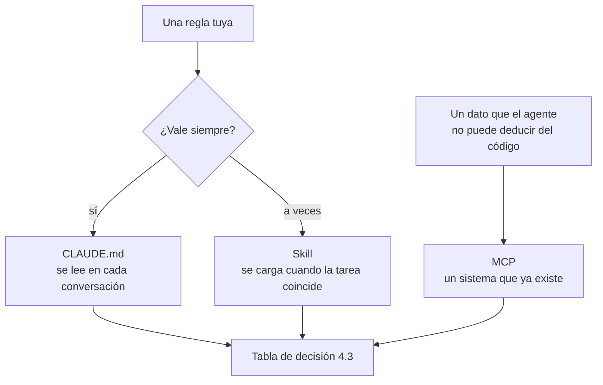

# Claude Code Ed. 5 — Sesión 4: Skills y MCP para tu forma de trabajar

## Este documento contiene la especificación completa de la sesión. Léelo completamente antes de ejecutar nada. No hagas suposiciones fuera de lo especificado.

**Prompts de la sesión (ejecutar en orden; versión completa y autocontenida de cada uno en `PROMPTS_sesion4.md`):**

0. "Ejecuta el Prompt 0 de `PROMPTS_sesion4.md`: verifica el terreno."
1. "Lee `Ed5_sesion4.md` completo y confírmame que entiendes el alcance. No ejecutes nada todavía."
2. "Ejecuta la Fase 4.1: escribe mi primera Skill desde una convención de mi proyecto."
3. "Ejecuta la Fase 4.2: conecta un servidor MCP que ya existe, en solo lectura."
4. "Ejecuta la Fase 4.3: escribe mi tabla de decisión."
5. "Ejecuta el Prompt de cierre de `PROMPTS_sesion4.md`: bitácora y push."

---

## Objetivo general

El alumno termina con una Skill suya que se carga sola cuando la tarea coincide
con su descripción, con un servidor MCP conectado en solo lectura al que el
agente le hace una consulta real, y con una tabla de decisión escrita que dice
cuándo usar el `CLAUDE.md`, cuándo una Skill, cuándo MCP, cuándo un subagente y
cuándo un hook.

## Objetivos específicos

* Saca del `CLAUDE.md` una regla que solo hace falta a veces y la convierte en
  Skill, con una `description` que diga **cuándo** usarla.
* Comprueba las **dos** cosas: que la Skill se active ante una petición que
  coincide, y que **no** se active ante una que no.
* Conecta un servidor MCP existente, con ámbito de proyecto y en modo de solo
  lectura, y obtiene de él un dato que el agente no podía deducir del código.
* Escribe una tabla de decisión de cinco filas con sus propios casos.
* Sabe lo que cuesta cada herramienta que conecta, y lo dice en tokens.

---

## Qué vas a construir, en palabras simples

Tu `CLAUDE.md` es un contrato que el agente lee **entero, en cada conversación**.
Eso está bien para las reglas que valen siempre, y es caro para las que solo
hacen falta de vez en cuando: las pagas todo el curso aunque las uses una vez
por semana.

Hoy haces dos cosas con eso.

La primera: sacas una de esas reglas del contrato y la conviertes en una
**Skill**, que es una carpeta con instrucciones que el agente carga **solo
cuando la tarea coincide con su descripción**. Lo único que ocupa contexto
mientras tanto es esa descripción.

La segunda: le das al agente acceso a un sistema que ya existe y que él no
puede leer por su cuenta, a través de **MCP**. En esta sesión, sus propias
conversaciones guardadas: las mismas que `tokens.py` lee para medir el costo.

Y cierras con la **tabla de decisión**, que es lo que vas a usar el resto del
curso para saber dónde poner cada cosa.



## Glosario mínimo

| Término | En una línea |
|---|---|
| **Skill** | Una carpeta con un `SKILL.md` que el agente carga cuando la tarea coincide con su descripción. |
| **`description`** | La línea del `SKILL.md` que dice qué hace y **cuándo** usarla. Es lo único que el agente tiene siempre en contexto. |
| **Carga bajo demanda** | Que lo grande de una Skill —archivos de apoyo, scripts— solo se lee cuando hace falta. |
| **MCP** | El protocolo con el que el agente habla con un sistema externo que ya existe. |
| **Servidor MCP** | El programa que expone ese sistema. Hoy conectas uno; construir uno es otro curso. |
| **Ámbito de un servidor** | Dónde queda escrito: local (solo tú), proyecto (`.mcp.json`, se commitea) o usuario (todos tus proyectos). |
| **Modo de solo lectura** | Que el servidor registre únicamente sus herramientas de lectura. Lo impone el servidor, no el agente. |

---

## Antes de empezar: tareas humanas

1. **Comprobar la versión de Claude Code**, en el entorno donde vas a trabajar
   —la terminal y el editor pueden tener versiones distintas—:

   ```bash
   claude --version
   ```

   Si está por debajo de **2.1.283**, actualizar: `claude update`. Dos minutos,
   sin costo.

2. **Comprobar que `npx` funciona**, porque el servidor MCP de hoy se descarga
   con él la primera vez:

   ```bash
   npx --version
   ```

   Viene con Node, que ya instalaste en la sesión 1. Si falla, avisar al
   docente antes de la fase 4.2.

No hace falta crear ninguna cuenta ni ningún token. El servidor de hoy no pide
credenciales.

## Estado de partida

| Debe existir | Dónde | Lo usa la fase |
|---|---|---|
| El `CLAUDE.md` escrito y auditado en la sesión 2 | raíz de `<RUTA_PROYECTO>` | 4.1, 4.3 |
| El inventario de daños | `docs/00-ANTES.md` §5 | 4.1 |
| `docs/MEDICIONES.md` con sus tres filas | `<RUTA_PROYECTO>` | 4.2 |
| `docs/COSTOS.md` con la regla de la sesión 3 | `<RUTA_PROYECTO>` | 4.3 |
| Las conversaciones guardadas del proyecto | la carpeta de proyectos de Claude Code en la máquina del alumno | 4.2 |
| `tokens.py`, que es quien imprime dónde está esa carpeta | `doc_sesions/sesion4/tokens.py` | 4.2 |
| El repositorio sin cambios pendientes | `<RUTA_PROYECTO>` | toda la sesión |
| Claude Code 2.1.283 o superior, y `npx` | la máquina del alumno | toda la sesión |

La carpeta de la sesión trae cuatro archivos para el alumno: esta spec, los
prompts, `TAREA_PATRON.md` y `tokens.py`. Los dos últimos son **copias
idénticas** de las de las sesiones anteriores, para que la carpeta funcione
sola. Si se modifican, se modifican todas: se comprueba con `diff` y tiene que
salir sin diferencias.

### Decisiones tomadas al preparar esta sesión

| # | Hallazgo | Resolución | Fase |
|---|---|---|---|
| 1 | **Una Skill y un comando con barra son la misma cosa.** `.claude/commands/<nombre>.md` sigue funcionando, pero es el formato legado y acepta el mismo frontmatter salvo `name` y `paths`. Una Skill se invoca con `/nombre` por defecto | No se enseñan como dos temas: se enseña la carpeta `.claude/skills/<nombre>/SKILL.md`, y se dice que además se puede invocar a mano | 4.1 |
| 2 | **Todos los campos del frontmatter son opcionales.** Solo `description` se recomienda, y si falta, Claude Code usa la primera línea no vacía del contenido | La fase gira entera alrededor de la `description`, y el criterio de aceptación son las **dos** comprobaciones: que se active y que no se active | 4.1 |
| 3 | **`description` y `when_to_use` se truncan a 1.536 caracteres juntos** en el listado que el modelo ve | El caso de uso va primero, y la regla queda escrita en la fase | 4.1 |
| 4 | **Editar una Skill se aplica en vivo**; solo hace falta `/reload-skills` si se creó una carpeta de Skills de nivel superior a mitad de sesión | Contrasta con el `CLAUDE.md`, que no se aplica hasta el siguiente `/clear`, y cierra un cabo de la sesión 2 | 4.1 |
| 5 | **El servidor MCP de SQLite está archivado**, sin parches ni correcciones, así que la base de datos de la app queda descartada como fuente | Se conecta el **servidor de archivos oficial**, `@modelcontextprotocol/server-filesystem`, apuntado a la carpeta donde Claude Code guarda las conversaciones del proyecto | 4.2 |
| 6 | **El servidor de GitHub existe pero su login desde Claude Code falla a menudo**, y el camino que funciona de forma consistente pide un token personal por alumno | Descartado para clase: medio grupo se quedaría en el login, y el curso prohíbe que las claves pasen por el chat | 4.2 |
| 7 | **La documentación oficial no describe ningún modo de solo lectura para MCP en general**: para bases de datos recomienda un usuario de solo lectura en la cadena de conexión | Pero el servidor de archivos **sí trae `--read-only`**, y lo impone el servidor: registra solo las herramientas anotadas como de lectura, así que las de escritura no existen para el cliente. Verificado el 2026-11-13 corriendo el servidor | 4.2 |
| 8 | **La salida de una herramienta MCP entra al contexto y se paga**, con un tope por defecto de 25.000 tokens (`MAX_MCP_OUTPUT_TOKENS`) | Es la lámina que enlaza con la sesión 3, y la razón de apuntar el servidor a una carpeta concreta y no a todo el disco | 4.2 |
| 9 | **Conectar o quitar un servidor MCP rompe la caché** de la conversación: cambia la capa de arriba de la petición | Se dice en clase, con la tabla de la sesión 3 en la mano. No se conecta ni se desconecta nada a mitad de una medición | 4.2 |
| 10 | Los nombres de herramienta son `mcp__<servidor>__<herramienta>`, y se usan en reglas de permisos, en `allowed-tools` y en los hooks | Se nombran y se dejan: los permisos y los hooks son la sesión 6, y la tabla de decisión los reserva | 4.2, 4.3 |
| 11 | **El servidor de archivos se descarga con `npx` la primera vez**, así que la primera conexión necesita internet y tarda | Va en las tareas humanas, y el Prompt 0 comprueba `npx` antes de llegar a la fase | 4.2 |

---

## Mapa de fases y dependencias

| Fase | Qué entrega (en una línea) | Depende de | Se verifica con |
|---|---|---|---|
| 4.1 | Una Skill del alumno en `.claude/skills/`, con su `description` | Prompt 0 | `/skills` la lista, se activa ante una petición que coincide y **no** ante una que no |
| 4.2 | Un servidor MCP conectado en solo lectura, y una consulta real respondida | 4.1 | `/mcp` dice `Connected`, y el agente responde algo que no está en el código |
| 4.3 | `docs/DECISIONES.md` con la tabla de cinco filas | 4.2 | El archivo existe y cada fila tiene un caso del propio alumno |

## Convenciones transversales

* **La Skill nace del inventario de daños**, igual que las reglas del
  `CLAUDE.md` en la sesión 2. No se inventa una Skill de ejemplo.
* **No se escriben reglas nuevas en el `CLAUDE.md`.** Hoy se mueve una que ya
  existe, o se escribe una que el inventario respalda y que no cabía ahí.
* **MCP: solo se conecta, nunca se construye.**
* **Lo que se conecta se conecta en solo lectura**, y con ámbito de proyecto.
* **Ninguna clave pasa por el chat ni al repositorio.** El servidor de hoy no
  pide ninguna; si alguien conecta otro que sí, el valor no se escribe en
  `.mcp.json`.
* **Cada fase deja su comprobación ejecutada**, no descrita.

---

# FASES

## Fase 4.1 — Tu primera Skill

**Prompt sugerido:** "Ejecuta la Fase 4.1 de `Ed5_sesion4.md`."

### Qué se construye

Una carpeta `.claude/skills/<nombre>/` con un `SKILL.md` dentro, que el agente
carga solo cuando la tarea coincide con su descripción. Sale de una convención
del propio proyecto del alumno, y su `description` dice cuándo usarla, con
peticiones reales entre comillas.

### Depende de

El Prompt 0, el `CLAUDE.md` de la sesión 2 y el inventario de `docs/00-ANTES.md`.

### Archivos

| Archivo | Rol |
|---|---|
| `.claude/skills/<nombre>/SKILL.md` | La Skill. Nace en esta fase. |
| `CLAUDE.md` | Se lee para elegir qué regla se va. Si la regla se mueve entera, se borra de aquí. |
| `docs/00-ANTES.md` | Se lee el inventario de daños. **No se modifica.** |

### Reglas

* **La `description` es el entregable de la fase, no el contenido.** Tiene que
  decir qué hace la Skill, **cuándo** usarla —con dos o tres peticiones reales
  entre comillas— y **qué no cubre**.
* **El caso de uso va primero**, porque `description` y `when_to_use` se
  truncan a 1.536 caracteres juntos en el listado que el modelo ve.
* **El `---` de apertura va en la primera línea del archivo.** Si no, el
  frontmatter se lee como contenido y la Skill queda sin descripción. Es la
  causa número uno de "mi Skill no carga".
* **Lo que el `SKILL.md` no necesita siempre va en archivos de apoyo**, y los
  comandos van en `scripts/`, que se ejecutan y no ocupan contexto. Se
  referencian con `${CLAUDE_SKILL_DIR}`.
* **Si la regla se mueve, se borra del `CLAUDE.md`.** Una regla en los dos
  sitios se paga dos veces y se contradice sola el día que una cambie.
* **La fase no está hecha con una comprobación.** Son dos: que se active y que
  no se active.

### Cómo verificar al terminar

1. `/skills` → la Skill aparece en la lista.
2. Una petición que coincide con la `description` → la Skill se carga sola, sin
   que el alumno la invoque.
3. Una petición que **no** coincide → la Skill **no** se carga.
4. `/skill-doctor` → dice cuánto ocupa la Skill en contexto.
5. Si la regla se movió del `CLAUDE.md`, `wc -l CLAUDE.md` tiene menos líneas
   que antes y la regla no está en los dos sitios.

---

## Fase 4.2 — Conectar un servidor que ya existe

**Prompt sugerido:** "Ejecuta la Fase 4.2 de `Ed5_sesion4.md`."

### Qué se construye

Un servidor MCP conectado al proyecto, en solo lectura, apuntado a la carpeta
donde Claude Code guarda las conversaciones de ese proyecto. Y una consulta
real: algo que el agente no puede responder leyendo el código, y que con el
servidor sí responde.

### Depende de

La Fase 4.1, y que `npx` funcione.

### Archivos

| Archivo | Rol |
|---|---|
| `.mcp.json` | Nace en esta fase, en la raíz. Lo escribe `claude mcp add --scope project`. Se commitea. |
| `doc_sesions/sesion4/tokens.py` | Se corre para saber **dónde** está la carpeta de conversaciones: la imprime en su segunda línea. |

### Reglas

* **El servidor se conecta con ámbito de proyecto**, para que quede en
  `.mcp.json` y lo tenga el equipo al clonar.
* **Siempre con `--read-only`.** El servidor entonces registra solo sus
  herramientas de lectura, y las de escritura no existen para el cliente. Lo
  impone el servidor, no el agente ni el alumno.
* **La carpeta que se le pasa es la del proyecto, no todo el disco.** La
  imprime `tokens.py` al correrlo. Apuntar más arriba es darle acceso a
  conversaciones de otros proyectos, y además hace que cualquier búsqueda
  devuelva de más.
* **La consulta tiene que ser algo que el código no pueda contestar.** "¿Qué
  decisiones no pedidas enumeraste en la corrida B?" vale; "¿qué hace
  `page.tsx`?" no, porque eso lo lee solo.
* **No se construye ningún servidor.** Si alguien quiere el suyo, es
  *AI Agentic Engineer*.
* **Nada de conectar y desconectar servidores a mitad de una medición**:
  cambia la capa de arriba de la petición y rompe la caché.

### Cómo verificar al terminar

1. `/mcp` → el servidor aparece y dice `Connected`.
2. `.mcp.json` existe en la raíz y nombra el servidor con `--read-only` entre
   sus argumentos.
3. El agente responde una pregunta sobre una conversación pasada, y cita de qué
   archivo la sacó.
4. Se le pide escribir algo por el servidor → **no puede**, porque esa
   herramienta no está registrada.

---

## Fase 4.3 — Tu tabla de decisión

**Prompt sugerido:** "Ejecuta la Fase 4.3 de `Ed5_sesion4.md`."

### Qué se construye

`docs/DECISIONES.md`: una tabla de cinco filas que dice dónde va cada cosa, con
un caso del propio alumno en cada fila. Es lo que las sesiones 5 y 6 van a
citar para decidir.

### Depende de

Las fases 4.1 y 4.2, porque tres de las cinco filas se llenan con lo que acaba
de hacer.

### Archivos

| Archivo | Rol |
|---|---|
| `docs/DECISIONES.md` | Nace aquí. Cinco filas y nada más. |

### Reglas

* **Cinco filas, y tiene que caber en media pantalla.** Una tabla de decisión
  que no se lee de un vistazo no se usa.
* **Cada fila lleva un caso del alumno**, no el del ejemplo. La del `CLAUDE.md`
  con una regla suya, la de la Skill con la que escribió hoy, la de MCP con el
  servidor que conectó.
* **Las dos últimas filas se dejan nombradas**, con la sesión en la que se
  hacen: subagente en la 5, hook en la 6.
* **No se decide hoy nada de las sesiones 5 y 6.** Se reserva el sitio.

### Cómo verificar al terminar

1. `docs/DECISIONES.md` existe y tiene exactamente cinco filas.
2. Las tres primeras filas nombran algo del proyecto del alumno.
3. Las dos últimas dicen en qué sesión se hacen.

---

## Si algo falla

| Síntoma | Causa más probable | Qué hacer |
|---|---|---|
| La Skill no aparece en `/skills` | la carpeta o el nombre del archivo están mal | tiene que ser `.claude/skills/<nombre>/SKILL.md`, exactamente |
| La Skill aparece pero nunca se activa sola | la `description` no dice **cuándo** usarla | reescribirla con peticiones reales entre comillas, el caso de uso primero |
| La Skill se activa cuando no debe | la `description` es demasiado amplia | agregarle qué **no** cubre, nombrando lo que sí lo cubre |
| Se editó la Skill y no cambió nada | se creó una carpeta de Skills de nivel superior a mitad de sesión | `/reload-skills`. Si solo se editó una Skill que ya existía, se aplica en vivo y el problema es otro |
| El frontmatter no se parsea | el `---` no está en la primera línea, o la indentación | la Skill **carga igual, sin ningún campo puesto**, así que parece que la descripción no sirve cuando el problema es el formato |
| `/mcp` dice `Failed to connect` | `npx` no encontró el paquete, o la ruta de la carpeta está mal escrita | `claude mcp get <nombre>` para ver qué quedó configurado, y comprobar la ruta con la que imprime `tokens.py` |
| La primera conexión tarda mucho | `npx` está descargando el servidor | es normal la primera vez. Si no hay internet, la fase no se puede hacer |
| El agente dice que no puede escribir por el servidor | está en `--read-only` | **no es un fallo: es el resultado.** Es la comprobación 4 de la fase |
| La respuesta del servidor se corta | el tope de salida, 25.000 tokens por defecto | acotar la pregunta. Y es la lámina del costo: esa salida entra al contexto y se paga |
| Al compañero no le arranca el servidor al clonar | los servidores de `.mcp.json` piden aprobación la primera vez | aceptarla cuando Claude Code la pida, o `claude mcp reset-project-choices` para volver a preguntar |
| El alumno quiere conectar el MCP de su base de datos | el de SQLite está archivado | hoy no. Y si fuera otro motor, con un usuario de solo lectura en la cadena de conexión |

## Restricciones de la sesión

* **No se construye ningún servidor MCP**: eso es *AI Agentic Engineer*.
* **No se conecta nada que pida credenciales.** El servidor de hoy no pide
  ninguna.
* **No se crean subagentes**: sesión 5. Se nombran, porque la tabla los
  necesita.
* **No se tocan permisos ni hooks**: sesión 6. Se nombran igual.
* **No se empaqueta nada**: el plugin es la sesión 8.
* **No se corrigen los defectos del inventario**: sesiones 5, 6 y 7.
* **No se corre la tarea patrón.** La tabla de `docs/MEDICIONES.md` quedó
  cerrada en la sesión 3 y hoy no se toca.

## Entregables

1. `.claude/skills/<nombre>/SKILL.md`, con las dos comprobaciones hechas.
2. `.mcp.json` en la raíz, con el servidor en solo lectura.
3. `docs/DECISIONES.md` con la tabla de cinco filas.
4. La entrada de la sesión 4 en `docs/BITACORA.md`.
5. Un commit por fase, y todo subido al repositorio.

## Producto de la sesión

El alumno se lleva su propia tabla de decisión, con una Skill y un servidor
suyos detrás, y sabe dónde poner cada regla sin pagarla en todas las
conversaciones.

## Criterios de aceptación

* La Skill del alumno se activa ante una petición que coincide con su
  descripción, y **no** se activa ante una que no. Las dos comprobaciones
  ejecutadas, no descritas.
* La `description` dice cuándo usarla, con al menos dos peticiones reales entre
  comillas, y dice qué no cubre.
* Si la regla se movió del `CLAUDE.md`, ya no está en los dos sitios.
* `.mcp.json` existe, el servidor dice `Connected` y sus argumentos incluyen
  `--read-only`.
* El agente respondió una consulta que el código no podía contestar, y dijo de
  qué archivo la sacó.
* `docs/DECISIONES.md` tiene cinco filas, las tres primeras con casos del
  propio alumno.
* Ninguna clave quedó en el repositorio ni pasó por el chat.

## Registro de cambios

**2026-11-13 — versión 1.** Primera versión de la spec. Los datos técnicos de
Skills y MCP se verificaron contra la documentación oficial el **13 de
noviembre de 2026**, y el servidor de la fase 4.2 se ejecutó ese mismo día para
comprobar que arranca y que `--read-only` existe. Tres decisiones de fondo
quedaron resueltas y están en los hallazgos 5, 6 y 7: la base de datos queda
fuera porque su servidor está archivado; GitHub queda fuera porque su login
falla y pediría un token por alumno; y el servidor de archivos entra porque no
pide credenciales y **sí** trae un modo de solo lectura que impone él mismo.

**Pendiente antes de dar la clase.** El laboratorio no se ha corrido entero de
principio a fin: falta el ensayo, que es el que convierte esta spec en material
dado. Y la presentación `Ed5_sesion4.pptx` ya está armada, pero se escribió
antes que esta spec: hay que comprobar que las dos digan lo mismo.
