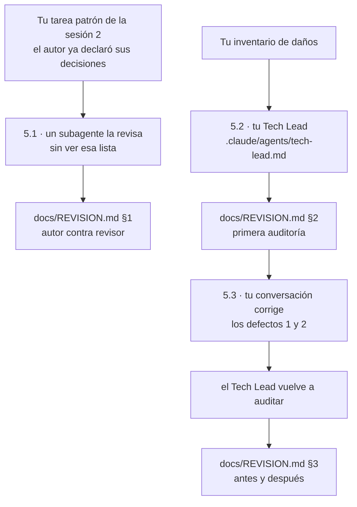

# Claude Code Ed. 5 — Sesión 5: Subagentes, el que escribe no es el que revisa

## Este documento contiene la especificación completa de la sesión. Léelo completamente antes de ejecutar nada. No hagas suposiciones fuera de lo especificado.

**Prompts de la sesión (ejecutar en orden; versión completa y autocontenida de cada uno en `PROMPTS_sesion5.md`):**

0. "Ejecuta el Prompt 0 de `PROMPTS_sesion5.md`: verifica el terreno."
1. "Lee `Ed5_sesion5.md` completo y confírmame que entiendes el alcance. No ejecutes nada todavía."
2. "Ejecuta la Fase 5.1: un subagente revisa mi tarea patrón sin mi historia."
3. "Ejecuta la Fase 5.2: escribe mi Tech Lead en `.claude/agents/`."
4. "Ejecuta la Fase 5.3: corrige lo que encontró y que vuelva a revisar."
5. "Ejecuta el Prompt de cierre de `PROMPTS_sesion5.md`: bitácora y push."

---

## Objetivo general

El alumno termina con un subagente revisor suyo, su Tech Lead, que vive en
`.claude/agents/`, revisa con una rúbrica que sale de su inventario de daños y
no puede editar código. Sabe, con datos de su propio proyecto, qué encuentra un
revisor sin la historia del autor que el autor no declaró. Y deja corregidos los
defectos 1 y 2 de su inventario, con el antes y el después comprobados por el
revisor y no por quien corrigió.

## Objetivos específicos

* Delega una revisión a un subagente incluido y ve qué vuelve a su
  conversación y qué se queda en el archivo del subagente.
* Compara las decisiones no pedidas que el agente autor declaró de su tarea
  patrón con las que encuentra un revisor que no vio esa conversación.
* Escribe su Tech Lead con `tools` sin `Edit`, `Write` ni `Bash`, con la Skill
  de la sesión 4 cargada si sirve para revisar, y con el modelo que dice su
  regla de costos.
* Comprueba dos cosas: que el Tech Lead audita y devuelve hallazgos con archivo
  y línea, y que si se le pide corregir, no puede.
* Corrige los defectos 1 y 2 en su conversación principal, y el Tech Lead
  confirma que desaparecieron.
* Llena la fila 4 de su tabla de decisión con un caso suyo.

---

## Qué vas a construir, en palabras simples

En las sesiones 2 y 3, al terminar cada corrida de la tarea patrón, le pediste
al agente que enumerara lo que había decidido sin que se lo pidieras. Esa lista
la escribió el mismo agente que había escrito el código, en la misma
conversación. Es decir, el autor se revisó a sí mismo.

Hoy pruebas qué pasa cuando revisa otro. Un **subagente** es un ayudante con su
propia ventana de contexto: no ve tu conversación, recibe un encargo, trabaja
aparte y te devuelve un resumen. Lo que leyó para llegar ahí se queda en su
archivo, no en tu conversación.

La sesión tiene tres pasos:

1. Un subagente que ya viene incluido revisa el commit de tu tarea patrón sin
   ver lo que el autor dijo de ella, y comparas las dos listas.
2. Escribes tu propio revisor, el **Tech Lead**, con una rúbrica que sale de tu
   inventario de daños y sin herramientas para editar.
3. Tu conversación principal corrige lo que encontró, y el Tech Lead vuelve a
   revisar. El que corrige no se revisa a sí mismo.



## Glosario mínimo

| Término | En una línea |
|---|---|
| **Subagente** | Un ayudante con su propia ventana de contexto, su propio prompt y sus propias herramientas. Devuelve un resumen. |
| **Encargo** | El mensaje que Claude le escribe al subagente al delegar. Es lo único de tu conversación que el subagente ve. |
| **`general-purpose`** | Un subagente que ya viene incluido en Claude Code. Recibe tu `CLAUDE.md` y puede usar todas las herramientas. |
| **Fork** | Un subagente que hereda tu conversación entera. Para revisar no sirve, porque hereda también tus supuestos. |
| **Tech Lead** | El subagente revisor que escribes hoy. El nombre viene del laboratorio del programa y de la Skill del ejemplar. |
| **Rúbrica** | La lista de preguntas con la que el Tech Lead revisa. Cada una se responde leyendo el código. |
| **`tools`** | El campo del archivo del subagente que dice qué herramientas puede usar. Si no está, puede usar todas. |
| **`skills`** | El campo que carga una Skill entera dentro del subagente al arrancar. |

---

## Antes de empezar: tareas humanas

1. **Comprobar la versión de Claude Code** en el entorno donde vas a trabajar:

   ```bash
   claude --version
   ```

   Tiene que ser 2.1.283 o superior, el mismo mínimo de la sesión 4. Si está
   por debajo: `claude update`. Dos minutos, sin costo.

2. **Saber en qué modo de aprobación trabajas**, el que elegiste en la sesión 1.
   No hay que cambiarlo: el Prompt 0 te lo pregunta, porque el subagente
   trabaja en ese mismo modo.

No hace falta crear ninguna cuenta ni ningún token.

## Estado de partida

| Debe existir | Dónde | Lo usa la fase |
|---|---|---|
| El `CLAUDE.md` de la sesión 2 | raíz de `<RUTA_PROYECTO>` | 5.1, 5.2 |
| El inventario de daños | `docs/00-ANTES.md` §5 | 5.2, 5.3 |
| La fila S2 de la tabla, con sus decisiones no pedidas, y el enunciado al pie | `docs/MEDICIONES.md` | 5.1 |
| El commit de la tarea patrón de la Fase 2.3 | el historial de git | 5.1 |
| La regla de la sesión 3 | `docs/COSTOS.md` | 5.2 |
| La Skill de la sesión 4 | `.claude/skills/<nombre>/SKILL.md` | 5.2 |
| El servidor MCP `conversaciones`, en solo lectura | `.mcp.json` | 5.1 |
| La tabla de decisión con la fila 4 reservada | `docs/DECISIONES.md` | 5.1 |
| El repositorio sin cambios pendientes | `<RUTA_PROYECTO>` | toda la sesión |
| Claude Code 2.1.283 o superior | la máquina del alumno | toda la sesión |

Esta tabla está escrita desde lo que piden los prompts de las sesiones 1 a 4.
No se verificó contra un repositorio que haya terminado la sesión 4: el ensayo
de producción va por la Fase 3.2. Lo comprueba el Prompt 0.

La carpeta de la sesión trae cuatro archivos para el alumno: esta spec, los
prompts, `TAREA_PATRON.md` y `tokens.py`. Los dos últimos son copias idénticas
de las de las sesiones anteriores, para que la carpeta funcione sola. Hoy no se
corre ninguno de los dos.

### Decisiones tomadas al preparar esta sesión

| # | Hallazgo | Resolución | Fase |
|---|---|---|---|
| 1 | El programa promete para esta sesión un laboratorio de un "Tech Lead" que corrija malas prácticas en el código generado. En la Ed. 4 se hizo como Skill (`mercadotech-tech-lead` del ejemplar), así que corría en la misma conversación que había escrito el código | El Tech Lead se escribe como subagente, y la corrección la hace la conversación principal en la 5.3. Se cumple lo que promete el programa, con el revisor separado del autor | 5.2, 5.3 |
| 2 | El scorecard del Tech Lead del ejemplar tiene cinco dimensiones. Dos coinciden con los defectos 1 y 2 del inventario: responsabilidad única y valores ajustables centralizados | La rúbrica usa esas dos como marco para los defectos 1 y 2, y una pregunta por cada otro defecto que apareció. El formato del informe sale del `mercadotech-code-reviewer` del ejemplar | 5.2 |
| 3 | En las sesiones 2 y 3 el agente autor declaró sus decisiones no pedidas en la misma conversación donde escribió el código. Es una autorrevisión, y ya está escrita | Es la línea de comparación de la 5.1. La tarea patrón no se vuelve a correr: se revisa el commit que ya existe | 5.1 |
| 4 | El subagente puede leer archivos, y `docs/` tiene la lista del autor. Y el encargo lo escribe la conversación principal, que podría filtrarla | El encargo lleva solo el commit, el enunciado y qué es una decisión no pedida. El subagente no lee `docs/`. La conversación principal no lee `docs/MEDICIONES.md` hasta que el subagente vuelve. `docs/VERIFICACION_S5.md` no copia la lista | 5.1 |
| 5 | En el ensayo, el commit de la tarea patrón de la Fase 2.3 también cambió `docs/MEDICIONES.md`, con la fila S2 y la lista del autor: la Fase 2.3 pide llenar la fila en la misma conversación. Comprobado en `merc_tech3` el 16 nov 2026 | El encargo pide ver el cambio sin `docs/`: `git show <commit> -- . ':(exclude)docs'`. Que lo cumpla depende de que el subagente obedezca, y eso se dice: es lo que la 5.2 resuelve con `tools` | 5.1 |
| 6 | Verificado el 16 nov 2026: los subagentes reciben toda la jerarquía de `CLAUDE.md`, salvo Explore y Plan, que arrancan sin él | La 5.1 usa `general-purpose`, para que revise contra el contrato. El Tech Lead también lo recibe | 5.1, 5.2 |
| 7 | Un fork hereda la conversación entera, y Claude puede lanzar forks por su cuenta | El prompt de la 5.1 pide `general-purpose` por su nombre, y dice "no un fork" | 5.1 |
| 8 | Desde la v2.1.302, y en la terminal desde la v2.1.232, los subagentes que lanza Claude arrancan en segundo plano y el resultado llega como aviso en un turno posterior | Los prompts funcionan de las dos maneras: piden mostrar el resultado cuando vuelva, sin suponer que Claude espera | 5.1, 5.2, 5.3 |
| 9 | Claude Code vigila `.claude/agents/` solo si la carpeta existía al abrir la sesión. El primer archivo de una carpeta nueva no se carga hasta reiniciar | Las comprobaciones de la 5.2 se hacen en un chat nuevo, después de cerrar el chat donde se escribió el archivo | 5.2 |
| 10 | El ejemplo oficial de revisor lleva `Bash`, y con `Bash` un subagente puede escribir un archivo con un comando de consola | El Tech Lead lleva `tools: Read, Grep, Glob`. Las preguntas de la rúbrica se responden con esas tres. Cerrar la consola con permisos o hooks es la sesión 6 | 5.2 |
| 11 | Si la conversación principal está en auto, `acceptEdits` o `bypassPermissions`, el subagente corre en ese mismo modo y el `permissionMode` de su archivo se ignora | El archivo no lleva `permissionMode`. Lo que frena al Tech Lead es su lista de `tools` | 5.2 |
| 12 | El campo `skills` carga la Skill entera. Si la Skill nombrada no existe, se salta sin avisar, salvo en el log de depuración. Y una Skill con `disable-model-invocation: true` no se puede cargar | El Prompt 0 revisa la Skill de la sesión 4. Solo se carga si sirve para revisar código y no tiene ese campo; si no, el Tech Lead va sin `skills` y se anota en la bitácora | 5.2 |
| 13 | `tokens.py` no cuenta lo que gasta un subagente: Claude Code lo guarda en `<sesión>/subagents/agent-<id>.jsonl` y el script solo lee la carpeta del proyecto. Comprobado el 16 nov 2026 | Hoy no se mide costo y no se toca `docs/MEDICIONES.md`. La 5.1 muestra el archivo del subagente con el servidor de la sesión 4, sin abrirlo, para ver dónde quedó lo que no volvió | 5.1 |
| 14 | El inventario de `docs/00-ANTES.md` es la foto del antes, y la sesión 1 dice que no se toca | Que los defectos 1 y 2 se cerraron queda escrito en `docs/REVISION.md` §3 y en la bitácora, no en el inventario | 5.3 |
| 15 | En el ensayo, el defecto 1 apareció solo en parte: ningún `.tsx` ejecutaba SQL, pero una acción del servidor mezclaba SQL con validación, y las páginas obtenían los datos y los mostraban en el mismo archivo | La rúbrica describe qué mirar en términos generales, no una forma concreta del defecto, para que sirva con cualquier estructura de carpetas | 5.2 |

---

## Mapa de fases y dependencias

| Fase | Qué entrega (en una línea) | Depende de | Se verifica con |
|---|---|---|---|
| 5.1 | La revisión de tu tarea patrón hecha por un subagente, comparada con lo que declaró el autor, y la fila 4 de tu tabla | Prompt 0 | `docs/REVISION.md` §1 con las dos listas y el conteo; el archivo del subagente existe en `subagents/` |
| 5.2 | Tu Tech Lead en `.claude/agents/tech-lead.md`, y su primer informe | 5.1 | En un chat nuevo aparece al escribir `@`, audita con archivo y línea, y si le pides corregir no puede |
| 5.3 | Los defectos 1 y 2 corregidos por tu conversación, y la segunda auditoría | 5.2 | `npm run build` pasa, la página se ve igual, y el Tech Lead ya no encuentra lo corregido |

## Convenciones transversales

* **El que escribe no revisa.** El Tech Lead nunca corrige, y la conversación
  que corrige no revisa su propia corrección.
* **La rúbrica dice qué mirar, nunca dónde.** Ninguna ruta ni número de línea
  del inventario entra en el archivo del Tech Lead ni en un encargo.
* **Ningún revisor ve la lista del autor ni el inventario.** Los dos están en
  `docs/`, y los revisores no leen `docs/`.
* **Hoy no se mide costo.** `tokens.py` no cuenta a los subagentes, y la tabla
  de mediciones quedó cerrada en la sesión 3.
* Los comandos que empiezan con `/` y las menciones con `@` las escribe el
  alumno, no el agente.
* Un commit por fase.

---

# FASES

## Fase 5.1 — El revisor sin tu historia

**Prompt sugerido:** "Ejecuta la Fase 5.1 de `Ed5_sesion5.md`."

### Qué se construye

Un subagente `general-purpose` revisa el commit de tu tarea patrón de la sesión
2 y enumera las decisiones que el enunciado no pedía, sin ver la lista que el
agente autor escribió de sí mismo. Después comparas las dos listas, miras qué
volvió a tu conversación y dónde quedó lo demás, y llenas la fila 4 de tu tabla
de decisión.

### Depende de

El Prompt 0, que deja en `docs/VERIFICACION_S5.md` el commit de la tarea patrón
y el enunciado.

### Archivos

| Archivo | Rol |
|---|---|
| `docs/REVISION.md` | Nace en esta fase, con su sección 1: el autor contra el revisor. |
| `docs/DECISIONES.md` | Se cambia la fila 4: donde decía "sesión 5" va el caso del alumno. |
| `docs/VERIFICACION_S5.md` | Se lee antes de delegar. Tiene el commit y el enunciado, y no tiene la lista del autor. |
| `docs/MEDICIONES.md` | Se lee después de que el subagente vuelve. **No se modifica.** |

### Reglas

* **El revisor es `general-purpose`.** No Explore, que arranca sin el
  `CLAUDE.md`, y no un fork, que hereda la conversación.
* **El encargo lleva tres cosas y ninguna más**: el identificador del commit,
  el enunciado entre comillas, y qué es una decisión no pedida. Ni el número ni
  la lista del autor, ni ejemplos del proyecto.
* **El revisor no lee nada de `docs/`, y ve el commit sin `docs/`**:
  `git show <commit> -- . ':(exclude)docs'`. El commit de la Fase 2.3 suele
  traer la fila S2 dentro, con la lista del autor.
* **La conversación principal no lee `docs/MEDICIONES.md`, `docs/COSTOS.md` ni
  `docs/BITACORA.md` hasta que el subagente vuelve.** Si los leyera antes,
  podría filtrar la lista al escribir el encargo.
* **Si la lista del autor no está escrita en ningún archivo**, se compara contra
  el número de la celda de la fila S2, y se dice así.
* **Se compara lo que dijo cada uno, no quién tiene razón.** Si el revisor
  encuentra menos que el autor, se escribe igual.
* **El archivo del subagente se mira con el servidor `conversaciones` de la
  sesión 4**: su nombre y su tamaño, sin abrirlo.
* **La fila 4 lleva un caso del alumno**, no el del ejemplo.

### Cómo verificar al terminar

1. `docs/REVISION.md` §1 tiene las dos listas, y cuántas coinciden, cuántas solo
   declaró el autor y cuántas solo encontró el revisor, también para las
   marcadas con ⚠️.
2. `/context`, antes de delegar y cuando vuelve el resultado → las dos cifras
   quedan en §1. Son de pantalla: no van a ninguna tabla.
3. El servidor `conversaciones` muestra un archivo `agent-<id>.jsonl` dentro de
   una carpeta `subagents/`, con su tamaño, y está en §1.
4. `docs/DECISIONES.md` tiene la fila 4 con un caso del alumno.
5. `git status --short` → antes del commit, solo esos dos archivos de `docs/`.

---

## Fase 5.2 — Tu Tech Lead

**Prompt sugerido:** "Ejecuta la Fase 5.2 de `Ed5_sesion5.md`."

### Qué se construye

`.claude/agents/tech-lead.md`: un subagente que revisa código ya escrito con una
rúbrica que sale de tu inventario, que no tiene herramientas para editar, con
tu Skill de la sesión 4 cargada si sirve para revisar, y con el modelo que dice
tu regla de costos. Y su primer informe, sobre un módulo de tu app.

### Depende de

La Fase 5.1.

### Archivos

| Archivo | Rol |
|---|---|
| `.claude/agents/tech-lead.md` | Nace en esta fase. Se commitea. |
| `docs/00-ANTES.md` | Se lee el inventario para escribir la rúbrica. **No se modifica.** |
| `docs/COSTOS.md` | Se lee la regla para elegir el modelo. |
| `.claude/skills/<nombre>/SKILL.md` | Se lee para decidir si se carga. **No se modifica.** |
| `docs/REVISION.md` | Se agrega la sección 2, con el primer informe tal cual. |

### Reglas

* **El frontmatter lleva `name`, `description`, `tools` y `model`**, y `skills`
  solo si la Skill de la sesión 4 sirve para revisar código. No lleva
  `permissionMode`.
* **El `---` de apertura va en la primera línea.** Si no, el archivo se ignora
  sin avisar.
* **`tools: Read, Grep, Glob`.** Ni `Edit`, ni `Write`, ni `Bash`.
* **La `description` dice qué hace, cuándo usarlo** con dos o tres peticiones
  reales entre comillas, **y qué no hace**: no corrige.
* **Antes de escribir el archivo, una tabla de trazabilidad**, como la de la
  Fase 2.1: una fila por pregunta de la rúbrica, con la pregunta, la fila del
  inventario de la que sale, y cómo se comprueba con `Read`, `Grep` o `Glob`. Una
  pregunta que no llena las tres columnas se saca.
* **La rúbrica tiene una pregunta por cada defecto que apareció** en el
  inventario. Para los defectos 1 y 2 usa el marco del Tech Lead del ejemplar:
  responsabilidad única (un archivo que obtiene los datos, decide y los muestra
  a la vez) y valores ajustables en un solo sitio (números sueltos, o el mismo
  número repetido en dos archivos).
* **Ninguna ruta de archivo ni número de línea del inventario** entra en el
  archivo del Tech Lead.
* **El informe tiene este formato**, que sale del revisor del ejemplar:
  hallazgos separados en crítico, importante y sugerencia; cada uno con archivo
  y línea, la pregunta de la rúbrica que lo detectó y qué está mal en una línea;
  "ninguno" donde no hay hallazgos; y una nota que parte de 10 y baja 3 por
  crítico, 1 por importante y 0,25 por sugerencia, con el cálculo a la vista.
* **El cuerpo del archivo ordena tres cosas**: reporta y no edita; no lee nada
  de `docs/`; no inventa hallazgos para llenar una sección.
* **`skills`**: el nombre de la Skill de la sesión 4, solo si sirve para revisar
  código y no tiene `disable-model-invocation: true`.
* **`model`**: lo que diga la regla de `docs/COSTOS.md` para una tarea de
  revisión. Si la regla no habla de revisar, `inherit`.
* **Las comprobaciones se hacen en un chat nuevo.** La carpeta
  `.claude/agents/` es nueva, y Claude Code no la vigila hasta abrir otra
  sesión.
* **El primer informe se copia tal cual** a `docs/REVISION.md`. Quien lo copia
  no lo resume ni lo corrige.

### Cómo verificar al terminar

1. En un chat nuevo, al escribir `@` aparece `tech-lead (agent)` en el menú.
2. Se le pide auditar un módulo → devuelve un informe con severidades, archivo y
   línea, y su nota. Queda copiado en `docs/REVISION.md` §2.
3. Se le pide corregir el primer hallazgo → responde que no puede, y
   `git status --short` solo muestra `docs/REVISION.md`.
4. `head -1 .claude/agents/tech-lead.md` → `---`, y la línea `tools` no nombra
   `Edit`, `Write` ni `Bash`.

---

## Fase 5.3 — Corregir y volver a revisar

**Prompt sugerido:** "Ejecuta la Fase 5.3 de `Ed5_sesion5.md`."

### Qué se construye

Tu conversación principal corrige hasta tres hallazgos del informe que caen en
los defectos 1 y 2, la app sigue compilando y se ve igual, y el Tech Lead vuelve
a auditar el mismo módulo. El antes y el después quedan en `docs/REVISION.md`,
junto con qué defectos de tu inventario encontró el Tech Lead sin que nadie le
dijera dónde.

### Depende de

La Fase 5.2, porque se corrige desde su informe.

### Archivos

| Archivo | Rol |
|---|---|
| El código del módulo auditado | Se corrige lo que el informe señaló, y nada más. |
| Un archivo de constantes, si el defecto 2 lo pide | Va donde diga tu `CLAUDE.md`. Si no lo dice, el agente lo propone y tú eliges. |
| `docs/REVISION.md` | Se agrega la sección 3: el segundo informe, el antes y el después, y la tabla del inventario. La sección 2 no se toca. |

### Reglas

* **Se corrigen como máximo tres hallazgos, y solo de los defectos 1 y 2**,
  críticos primero. Los elige el alumno. Lo demás se anota.
* **Los defectos 3 y 4 se anotan y no se tocan**: son de las sesiones 6 y 7.
* **La corrección no cambia lo que la app hace.** Misma página, mismo resultado
  en el navegador.
* **`npm run build` tiene que pasar antes de la segunda auditoría.**
* **La segunda auditoría la hace el Tech Lead**, con el mismo encargo y el mismo
  módulo que la primera. La conversación que corrigió no se revisa a sí misma.
* **No se reescribe la sección 2** para que la comparación luzca mejor.
* **`docs/00-ANTES.md` y `docs/MEDICIONES.md` no se tocan.**
* **Si el Tech Lead no encontró un defecto que tú sí viste**, la lección es
  sobre la rúbrica: se anota qué pregunta faltaba o estaba mal escrita.

### Cómo verificar al terminar

1. `npm run build` → termina sin errores.
2. `npm run dev` y la página del módulo → se ve y se comporta igual que antes.
3. El segundo informe ya no trae los hallazgos corregidos, y `docs/REVISION.md`
   §3 tiene la nota de antes y la de después.
4. `docs/REVISION.md` §3 tiene una fila por cada defecto que apareció en el
   inventario de la sesión 1, con si el Tech Lead lo encontró sin que se le
   dijera dónde.
5. `git log --oneline -1` → el commit de la fase.

---

## Si algo falla

| Síntoma | Causa más probable | Qué hacer |
|---|---|---|
| El Tech Lead no aparece al escribir `@` | la carpeta `.claude/agents/` es nueva y la sesión no la vigila | cerrar el chat y abrir uno nuevo. Si sigue sin aparecer, mirar que el `---` esté en la primera línea |
| Sigue sin aparecer en un chat nuevo | el `---` no está en la primera línea, o falta `name` o `description` | el archivo se ignora sin avisar. `claude --debug` y buscar el nombre en el log |
| Claude revisa él mismo en vez de delegar | el prompt no nombró al subagente | nombrarlo: `general-purpose` en la 5.1, `@"tech-lead (agent)"` en la 5.2 y la 5.3 |
| Claude lanzó un fork en la 5.1 | fork mode está activo y el pedido no fue explícito | repetir con "un subagente `general-purpose`, no un fork" |
| El resultado no llega y Claude sigue trabajando | el subagente corre en segundo plano | es normal desde la v2.1.302. Esperar el aviso; `/tasks` muestra lo que corre |
| El revisor de la 5.1 menciona la lista del autor | leyó `docs/`, o el encargo la llevaba | repetir la 5.1 desde el principio en un chat nuevo. La comparación ya no vale |
| La lista del autor no está escrita en ningún archivo | en la sesión 2 quedó solo en el chat | comparar contra el número de la celda de la fila S2, y decirlo en §1 |
| El Tech Lead editó un archivo | `tools` no está escrito, o incluye `Edit`, `Write` o `Bash` | `git restore` del archivo, y escribir `tools: Read, Grep, Glob` |
| Se puso `permissionMode` y no cambió nada | la conversación está en auto, `acceptEdits` o `bypassPermissions` | es así por diseño. El freno es `tools`, y el archivo no lleva `permissionMode` |
| El Tech Lead no aplica lo que dice la Skill de la sesión 4 | la Skill no se cargó: el nombre no coincide, o tiene `disable-model-invocation: true` | `claude --debug` muestra el aviso. Corregir el nombre, o quitar `skills` y anotarlo |
| El Tech Lead no encuentra nada | la rúbrica es genérica | reescribir las preguntas desde el inventario, no desde buenas prácticas en general |
| El Tech Lead encuentra menos que tu inventario | falta una pregunta, o está mal escrita | corregir la rúbrica, no el informe, y volver a pasarlo |
| `npm run build` falla después de corregir | la corrección cambió una firma o un import | diagnosticar antes de seguir. Si no se resuelve, `git restore` y corregir un hallazgo menos |

## Restricciones de la sesión

* **No se mide costo.** `tokens.py` no cuenta a los subagentes, y
  `docs/MEDICIONES.md` no se toca.
* **No se corre la tarea patrón.** Se revisa el commit que ya existe.
* **No se corrigen los defectos 3 y 4**: sesiones 6 y 7.
* **No se tocan permisos ni hooks**: sesión 6. Se nombra que con `Bash` un
  revisor podría escribir.
* **No se conecta ningún servidor MCP nuevo.** Se usa el de la sesión 4.
* **No se empaqueta nada**: el plugin es la sesión 8.
* Memoria propia del subagente, worktree aparte y subagentes anidados no se
  usan.
* Ninguna clave pasa por el chat ni por el repositorio (`CONVENCIONES.md` §6).

## Entregables

1. `.claude/agents/tech-lead.md`, con `tools` sin `Edit`, `Write` ni `Bash`.
2. `docs/REVISION.md` con sus tres secciones: el autor contra el revisor, la
   primera auditoría, y el después.
3. La fila 4 de `docs/DECISIONES.md` con un caso del alumno.
4. Los defectos 1 y 2 corregidos en el módulo auditado, o escrito por qué no.
5. La entrada de la sesión 5 en `docs/BITACORA.md`.
6. Un commit por fase, y todo subido al repositorio.

## Producto de la sesión

Un subagente revisor que audita su app.

## Criterios de aceptación

* `docs/REVISION.md` §1 compara las decisiones que declaró el autor con las que
  encontró un subagente que no vio esa conversación, y dice cuántas coinciden.
* El revisor de la 5.1 no leyó `docs/` ni recibió la lista del autor.
* `.claude/agents/tech-lead.md` empieza con `---` y su `tools` es
  `Read, Grep, Glob`.
* El Tech Lead auditó un módulo con archivo y línea, y cuando se le pidió
  corregir, no pudo. Las dos cosas ejecutadas, no descritas.
* La rúbrica no contiene ninguna ruta ni número de línea del inventario.
* `npm run build` pasa después de la corrección, y la segunda auditoría la hizo
  el Tech Lead.
* `docs/00-ANTES.md` y `docs/MEDICIONES.md` no cambiaron en toda la sesión.
* Ninguna clave quedó en el repositorio ni pasó por el chat.

## Registro de cambios

**2026-11-16 — versión 1.** Primera versión de la spec. Los datos técnicos de
subagentes se verificaron contra la documentación oficial el 16 de noviembre de
2026. El diseño del laboratorio sale de cruzar tres fuentes: el plan de
producción (`PLAN_ED5_SESIONES.md`, Fase S.5), el laboratorio que el programa
promete para esta sesión (un Tech Lead que corrige malas prácticas del código
generado), y lo que dejan en el repositorio del alumno los laboratorios 1 a 4.

**Pendiente antes de dar la clase.** Esta spec no se ha ejecutado. Falta el
ensayo, y con él la verificación que pide el plan: que el revisor encuentre
sobre la app del ensayo al menos dos de los cuatro defectos del inventario, sin
que se le digan. También falta comprobar en la versión de clase que el campo
`skills` carga la Skill dentro del subagente.
