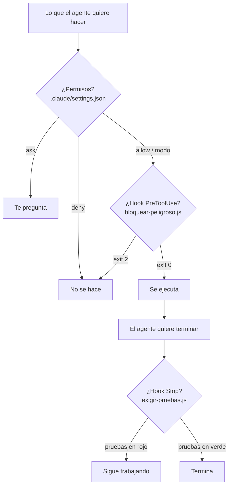

# Claude Code Ed. 5 — Sesión 6: Permisos, hooks y red de seguridad

## Este documento contiene la especificación completa de la sesión. Léelo completamente antes de ejecutar nada. No hagas suposiciones fuera de lo especificado.

**Prompts de la sesión (ejecutar en orden; versión completa y autocontenida de cada uno en `PROMPTS_sesion6.md`):**

0. "Ejecuta el Prompt 0 de `PROMPTS_sesion6.md`: verifica el terreno."
1. "Lee `Ed5_sesion6.md` completo y confírmame que entiendes el alcance. No ejecutes nada todavía."
2. "Ejecuta la Fase 6.1: escribe mi matriz de permisos."
3. "Ejecuta la Fase 6.2: un hook que bloquea lo peligroso antes de que se ejecute."
4. "Ejecuta la Fase 6.3: las pruebas mínimas y el hook que las exige."
5. "Ejecuta la Fase 6.4: deshacer lo que salió mal, y cerrar la red."
6. "Ejecuta el Prompt de cierre de `PROMPTS_sesion6.md`: bitácora, CLAUDE.md y push."

---

## Objetivo general

El alumno termina con una red de seguridad que no depende de que el modelo
obedezca: reglas de permisos que niegan o preguntan, un hook que bloquea
comandos destructivos y que el Tech Lead lea `docs/`, y un hook que no deja
dar una tarea por terminada si las pruebas fallan. Sabe deshacer lo que salió
mal y sabe qué se puede deshacer y qué no. Y cierra el defecto 3 de su
inventario: su app pasa de cero pruebas a una señal en verde que alguien exige.

## Objetivos específicos

* Convierte el riesgo que aceptó en la sesión 1 y las prohibiciones que los
  prompts repitieron sesión tras sesión en reglas `allow`, `ask` y `deny` de
  `.claude/settings.json`, y comprueba que una regla `deny` frena al agente aunque
  esté en modo auto.
* Escribe un hook `PreToolUse` que bloquea lo que una regla de permisos no
  alcanza a ver, y comprueba que bloquea y que deja pasar lo normal.
* Cierra el hueco que dejó la sesión 5: el Tech Lead ya no puede leer `docs/`,
  aunque intente.
* Agrega las pruebas mínimas a su app y un hook `Stop` que manda al agente de
  vuelta si las rompió.
* Usa `/rewind` para deshacer un cambio del agente, ve el caso que `/rewind` no
  cubre, y lo deshace con git.
* Protege la propia red: el agente no puede editar la configuración ni los
  hooks que lo frenan.
* Llena la fila 5 de su tabla de decisión con un caso suyo.

---

## Qué vas a construir, en palabras simples

Hasta hoy, todo lo que le dijiste al agente fueron **pedidos**. El `CLAUDE.md`
le pide que no agregue dependencias sin preguntar. La Skill le pide que no
guarde nada más en `localStorage`. El Tech Lead tiene escrito que no lea
`docs/`. Y cada prompt del curso repite "no toques `docs/00-ANTES.md`". Todo eso
funciona mientras el modelo obedece. En la sesión 5 lo viste fallar: el Tech
Lead tenía `Read`, y nada le impedía abrir `docs/` salvo su propia obediencia.

Hoy pones cosas que **se cumplen aunque el modelo no quiera**, porque no las
ejecuta el modelo: las ejecuta Claude Code.

1. **Permisos.** Una lista en `.claude/settings.json` que dice qué hace el
   agente solo, qué te pregunta antes y qué no hace nunca.
2. **Hooks.** Programas chicos que Claude Code corre en momentos fijos: antes de
   cada herramienta, o cuando el agente quiere terminar. Si el programa dice que
   no, el agente no puede.
3. **Pruebas.** La señal que un hook puede exigir. Sin pruebas, "terminé" es la
   palabra del agente. Con pruebas y un hook, es un resultado que se comprueba.
4. **Deshacer.** Lo que hacer cuando algo salió mal igual: `/rewind` para lo que
   el agente editó, y git para todo lo demás.



## Glosario mínimo

| Término | En una línea |
|---|---|
| **Regla de permisos** | Una línea en `allow`, `ask` o `deny` de `.claude/settings.json` que dice qué hace el agente con una herramienta o un archivo. |
| **`deny`** | No se hace nunca, en ningún modo. Gana a `allow` y a `ask`. |
| **`ask`** | Te pregunta antes, aunque estés en modo auto. |
| **`allow`** | Lo hace sin preguntar. Solo cuenta después de aceptar la confianza del proyecto. |
| **Hook** | Un programa que Claude Code corre en un momento fijo y que puede bloquear lo que el agente iba a hacer. |
| **`PreToolUse`** | El momento justo antes de que el agente use una herramienta. |
| **`Stop`** | El momento en que el agente quiere dar su respuesta por terminada. |
| **Exit 2** | El código de salida con el que un hook dice "no". Lo que el hook escribe en stderr es el motivo que lee el agente. |
| **Checkpoint** | La foto que Claude Code guarda de los archivos que editó, antes de cada mensaje tuyo. |
| **`/rewind`** | El comando que vuelve a un checkpoint: el código, la conversación o los dos. También con Esc dos veces. |
| **Sandbox** | Un aislamiento del sistema operativo para los comandos de consola del agente. No existe en Windows nativo. |

---

## Antes de empezar: tareas humanas

1. **Comprobar la versión de Claude Code**, en el entorno donde vas a trabajar:

   ```bash
   claude --version
   ```

   Tiene que ser 2.1.283 o superior. Si está por debajo: `claude update`.

2. **En Windows, tener Git for Windows instalado.** Claude Code corre los hooks
   con Git Bash. Ya lo tienes desde la sesión 1, porque es el mismo Git.

3. **Tener internet en la Fase 6.3.** Se instala una dependencia de pruebas con
   `npm`.

4. **Saber en qué modo de aprobación trabajas**, el de la sesión 1. El Prompt 0
   lo lee de tu `docs/00-ANTES.md` §3, junto con el riesgo que aceptaste.

No hace falta crear ninguna cuenta ni ningún token.

## Estado de partida

| Debe existir | Dónde | Lo usa la fase |
|---|---|---|
| El `CLAUDE.md`, con la regla que dice que no hay pruebas | raíz de `<RUTA_PROYECTO>` | 6.1, 6.3 |
| El modo de aprobación de la sesión 1 y el riesgo que aceptaste | `docs/00-ANTES.md` §3 | 6.1 |
| El inventario de daños, con el defecto 3 "Cero pruebas" | `docs/00-ANTES.md` §5 | 6.3 |
| El Tech Lead de la sesión 5 | `.claude/agents/tech-lead.md` | 6.2 |
| La tabla de decisión con la fila 5 reservada | `docs/DECISIONES.md` | 6.2 |
| Que no exista todavía `.claude/settings.json` ni `.claude/hooks/` | `<RUTA_PROYECTO>` | 6.1, 6.2 |
| El repositorio sin cambios pendientes | `<RUTA_PROYECTO>` | toda la sesión |
| Node 20 o superior, y Claude Code 2.1.283 o superior | la máquina del alumno | toda la sesión |

La carpeta de la sesión trae cuatro archivos para el alumno: esta spec, los
prompts, `TAREA_PATRON.md` y `tokens.py`. Los dos últimos son copias idénticas
de las de las sesiones anteriores, para que la carpeta funcione sola. Hoy no se
corre ninguno de los dos.

### Decisiones tomadas al preparar esta sesión

Todo lo que dice "ensayo" se ejecutó el 2026-11-18 con Claude Code real, en una
copia del proyecto de ensayo, sobre Windows. La documentación oficial se
consultó ese mismo día.

| # | Hallazgo | Resolución | Fase |
|---|---|---|---|
| 1 | El inventario dice que el defecto 4 "se cierra en S6 / S7", y el plan dice que el control de acceso de `/admin` se cierra aquí "con los permisos". Pero los permisos de esta sesión son los del agente, no los de la app: proteger `/admin` es código de la app, y no entra en cuatro fases | La sesión 6 cierra el **defecto 3**. El **defecto 4** pasa entero a la sesión 7, que trata la seguridad de la app y los secretos. Así lo decía ya la sesión 5: "los defectos 3 y 4 son de las sesiones 6 y 7" | toda |
| 2 | **Una regla `deny` bloquea en todos los modos, incluso auto y `bypassPermissions`.** Ensayo: con el agente en `acceptEdits`, la edición de `docs/00-ANTES.md` falló con "File is in a directory that is denied by your permission settings" | La matriz pone en `deny` lo que ningún modo debe poder hacer. Es la respuesta al modo auto que eligió el alumno en la sesión 1 | 6.1 |
| 3 | **Las reglas `allow` del proyecto no cuentan hasta aceptar la confianza del proyecto; `deny` y `ask` cuentan desde el primer momento.** Ensayo: "Ignoring 3 permissions.allow entries … this workspace has not been trusted" | Si el agente sigue pidiendo permiso para `npm test`, la causa es esa. Se acepta la confianza al abrir Claude Code en la carpeta | 6.1 |
| 4 | **Una regla `deny` de `Edit` cubre también lo que se escribe desde la consola con `>`, `>>`, `tee` o `sed`.** Ensayo: `echo prueba >> docs/00-ANTES.md` quedó bloqueado. No cubre comandos que escriben sin nombrar el archivo ni cualquier subproceso | La matriz no promete más de lo que cubre, y se dice en clase | 6.1 |
| 5 | **Una regla de `Bash` compara el comando contra un patrón**, y no frena el mismo programa por otro camino (`sh -c '…'`, una ruta completa) | Lo que tiene que encontrarse **en cualquier parte** del comando, como `git reset --hard` después de un `&&`, va en un hook, que lee el comando entero | 6.2 |
| 6 | **Exit 2 bloquea, exit 0 deja pasar, y cualquier otro código deja pasar con un aviso.** Un hook que se rompe abre la puerta en lugar de cerrarla | Los dos hooks se dan escritos y probados (anexo). El alumno los entiende y los comprueba; no los inventa en clase, porque un hook mal escrito bloquea o deja pasar sin que se note | 6.2, 6.3 |
| 7 | En Windows, Claude Code corre los hooks con Git Bash, o con PowerShell si no hay Git Bash. Un script de shell se comporta distinto en cada uno | Los hooks están escritos en **Node**, que el alumno ya tiene desde la sesión 1, y leen el evento como JSON sin herramientas extra. Funcionan igual en Windows, macOS y Linux | 6.2, 6.3 |
| 8 | **Los hooks de `.claude/settings.json` también corren dentro de los subagentes**, y el evento trae `agent_type` con el nombre del subagente. Ensayo: el Tech Lead pidió leer `docs/MEDICIONES.md` y el hook lo bloqueó; el Tech Lead respondió que el hook no lo dejaba | Cierra el hueco de la sesión 5 (sus decisiones 5 y 10): `tools` no impedía que el Tech Lead leyera `docs/`, y ahora sí hay algo que lo impide | 6.2 |
| 9 | **Un hook `Stop` con exit 2 manda al agente a seguir trabajando.** El evento trae `stop_hook_active`, que vale `true` si el agente ya volvió una vez por un hook. Ensayo: se pidió un cambio de formato sin mencionar las pruebas; al querer terminar, las pruebas fallaban, el hook lo mandó de vuelta y el agente actualizó la prueba al formato pedido | El hook deja parar al agente cuando `stop_hook_active` es `true`, para no entrar en bucle. Es **una vuelta obligatoria**, no infinitas, y se dice así | 6.3 |
| 10 | En el ensayo, el agente "arregló" las pruebas cambiando la prueba, no el código. En ese caso era correcto: el pedido cambiaba el comportamiento. Pero un agente también puede debilitar una prueba para que pase | La verificación de la 6.3 obliga a mirar el diff de la prueba: si la prueba cambió, que el cambio sea el que se pidió | 6.3 |
| 11 | **La primera prueba del ensayo falló por un espacio invisible**: el formato de moneda separa el símbolo del número con un espacio no separable, y la prueba lo escribía con un espacio común. El mensaje mostraba dos textos que parecían iguales | Va en la tabla de fallos. Es el error más probable en clase, y enseña que una prueba en rojo no siempre es código roto | 6.3 |
| 12 | Las pruebas son la señal que el hook exige, no un tema. Vitest y Playwright a fondo son *AI Agentic Engineer* | Se instala solo Vitest, como dependencia de desarrollo, y se prueban dos o tres funciones puras de la app: sin base de datos, sin red y sin páginas. La instalación pasa por la regla `ask` de la 6.1, y eso es a propósito | 6.3 |
| 13 | Correr las pruebas cada vez que el agente termina una respuesta las haría correr también cuando solo conversa | El hook las corre solo si cambió algo fuera de `docs/` (`git status`). En el ensayo, `npm test` tardó alrededor de 2 segundos con tres pruebas | 6.3 |
| 14 | **El sandbox no existe en Windows nativo.** La documentación: corre en macOS, Linux y WSL2; en Windows nativo los comandos corren sin aislar | La 6.4 lo explica y no lo ejecuta. Quien trabaja en macOS, Linux o WSL2 puede activarlo con `/sandbox`, como paso opcional. La red de hoy no depende de él | 6.4 |
| 15 | **`/rewind` solo deshace lo que el agente editó con sus herramientas de archivo.** Un archivo que solo cambió por un comando de consola no se restaura, ni lo que hizo un subagente, ni lo que editaste tú a mano. Los checkpoints duran unos 30 días y guardan los últimos 100 de una sesión | La 6.4 lo enseña rompiendo algo dos veces: una con la herramienta de edición, que `/rewind` deshace, y otra con la consola, que `/rewind` no ve y git sí. `/rewind` es interactivo y no se pudo ejecutar en el ensayo automático: lo comprueba el ensayo en clase | 6.4 |
| 16 | **El agente puede editar `.claude/settings.json` y los hooks**, es decir, quitar las reglas que lo frenan. Con `bypassPermissions` ni siquiera pregunta al escribir en `.claude/` | La 6.4 termina poniendo en `deny` la configuración y los hooks. Ensayo: el agente no pudo editar `.claude/settings.json` ni escribir en un hook con `>>`. Desde ahí, la red la cambia la persona | 6.4 |
| 17 | En Windows, aprobar algo con "Sí, y no preguntar de nuevo" escribe la regla en `.claude/settings.json`, el archivo que se commitea | Antes de cada commit de la sesión, `git diff .claude/settings.json`: que no haya entrado una regla que nadie decidió | 6.1–6.4 |
---

## Mapa de fases y dependencias

| Fase | Qué entrega (en una línea) | Depende de | Se verifica con |
|---|---|---|---|
| 6.1 | `docs/PERMISOS.md` con la matriz, y sus reglas en `.claude/settings.json` | Prompt 0 | En un chat nuevo: editar `docs/00-ANTES.md` falla, e instalar un paquete pregunta |
| 6.2 | El hook `PreToolUse` que bloquea comandos destructivos y que el Tech Lead lea `docs/`, y la fila 5 de la tabla | 6.1 | `/hooks` lo muestra; `git reset --hard` queda bloqueado y `git status` no; el Tech Lead no puede leer `docs/` |
| 6.3 | Las pruebas mínimas, el script `test`, el hook `Stop`, y la regla de pruebas del `CLAUDE.md` al día | 6.2 | `npm test` en verde; un cambio que rompe una prueba hace que el agente siga trabajando |
| 6.4 | Deshacer con `/rewind` y con git, y la red protegida contra el propio agente | 6.3 | `/rewind` deshace la edición; el cambio por consola se deshace con git; el agente no puede editar `.claude/settings.json` |

## Convenciones transversales

* **Pedir no es imponer.** Lo que hoy entra en `.claude/settings.json` deja de
  depender del modelo. Lo que sigue en el `CLAUDE.md` o en una Skill, sí depende.
* **Cada regla sale de algo que ya pasó**: del riesgo que aceptaste en la sesión
  1, de una regla de tu `CLAUDE.md`, o de un archivo que los prompts repitieron
  que no se toca. Una regla sin origen no entra.
* **Cada bloqueo se comprueba en los dos sentidos**: que frena lo que debe, y que
  deja pasar lo normal. Un hook que bloquea todo bloquea la clase.
* **Las comprobaciones se hacen en un chat nuevo**, después de escribir la
  configuración, igual que en las sesiones 4 y 5.
* **Hoy no se mide costo.** La tabla de mediciones quedó cerrada en la sesión 3.
* Los comandos que empiezan con `/` y las menciones con `@` las escribe el
  alumno, no el agente.
* Un commit por fase.

---

# FASES

## Fase 6.1 — Tu matriz de permisos

**Prompt sugerido:** "Ejecuta la Fase 6.1 de `Ed5_sesion6.md`."

### Qué se construye

Una tabla que dice, acción por acción, qué hace el agente solo, qué te pregunta
y qué no hace nunca, con el origen de cada decisión. Y esa misma tabla escrita
como reglas en `.claude/settings.json`, donde Claude Code la aplica.

### Depende de

El Prompt 0, que deja en `docs/VERIFICACION_S6.md` el modo de aprobación, el
riesgo que aceptaste en la sesión 1 y las reglas de tu `CLAUDE.md`.

### Archivos

| Archivo | Rol |
|---|---|
| `docs/PERMISOS.md` | Nace en esta fase: la matriz, una fila por regla, con su origen. |
| `.claude/settings.json` | Nace en esta fase, con la clave `permissions`. Se commitea: es la configuración del equipo. |
| `docs/00-ANTES.md` | Se lee §3, el modo y el riesgo. **No se modifica.** |
| `CLAUDE.md` | Se lee para encontrar las reglas que hoy solo piden. **No se modifica en esta fase.** |

### Reglas

* **Cada fila de la matriz tiene cuatro columnas**: la acción, la lista
  (`allow`, `ask` o `deny`), la regla exacta como va en el archivo, y de dónde
  sale. Si una fila no llena las cuatro, se saca. Es la misma tabla de
  trazabilidad de las fases 2.1 y 5.2.
* **De dónde sale cada regla**, y solo de estos tres sitios:
  1. el riesgo que aceptaste en la sesión 1, en `docs/00-ANTES.md` §3;
  2. una regla de tu `CLAUDE.md` que dice "pregunta antes" o "no";
  3. los archivos que los prompts del curso repiten que no se tocan:
     `docs/00-ANTES.md`, la foto de la sesión 1, y `docs/MEDICIONES.md`,
     cerrada en la sesión 3.
* **`deny` para lo que ningún modo debe poder hacer**: editar esos dos archivos.
* **`ask` para lo que tiene que pasar por ti**: instalar dependencias, borrar la
  base de datos de la app, publicar en el remoto.
* **`allow` solo para comandos que solo leen o comprueban**, para que el modo
  manual pregunte menos: el chequeo de tipos y el build.
* **La sintaxis**: `Edit(./ruta)` para un archivo del proyecto, y
  `Bash(comando *)` para un comando y todo lo que lleve detrás.
* **No se toca el modo de aprobación** ni se agrega `defaultMode`. La matriz
  funciona en el modo que ya tienes.
* **No se escribe ningún hook todavía.** Eso es la 6.2.
* **Las comprobaciones se hacen en un chat nuevo.**

### Cómo verificar al terminar

1. `/permissions`, en un chat nuevo → aparecen tus reglas, y al lado el archivo
   de donde salen: `.claude/settings.json`.
2. Se le pide al agente agregar una línea a `docs/00-ANTES.md` → no puede, y el
   mensaje dice que los permisos lo niegan. `git status --short` no muestra ese
   archivo.
3. Se le pide instalar un paquete cualquiera → Claude Code te pregunta antes. Lo
   rechazas.
4. `docs/PERMISOS.md` tiene una fila por regla, cada una con su origen.

---

## Fase 6.2 — El hook que bloquea

**Prompt sugerido:** "Ejecuta la Fase 6.2 de `Ed5_sesion6.md`."

### Qué se construye

Un programa chico, `.claude/hooks/bloquear-peligroso.js`, que Claude Code corre
antes de cada comando de consola y de cada lectura. Bloquea dos cosas que una
regla de permisos no alcanza: un comando destructivo escondido en medio de otro
comando, y que el Tech Lead lea `docs/`. Y la fila 5 de tu tabla de decisión.

### Depende de

La Fase 6.1, porque el hook se registra en el mismo `.claude/settings.json`.

### Archivos

| Archivo | Rol |
|---|---|
| `.claude/hooks/bloquear-peligroso.js` | Nace en esta fase. El texto exacto está en el anexo. |
| `.claude/settings.json` | Gana la clave `hooks`, con el evento `PreToolUse`. Las reglas de la 6.1 no se tocan. |
| `docs/PERMISOS.md` | Gana una sección: qué bloquea el hook y por qué no podía hacerlo una regla. |
| `docs/DECISIONES.md` | La fila 5 deja de decir "sesión 6" y lleva tu caso. |

### Reglas

* **El hook es el del anexo, tal cual.** Se copia, no se reescribe. Si el agente
  propone cambios, los dice y no los aplica.
* **Bloquea dos cosas y ninguna más**: `git reset --hard`, `git push --force`,
  `git clean -f` y `rm -rf` en cualquier parte de un comando; y `Read`, `Grep` o
  `Glob` sobre `docs/` cuando quien los usa es el subagente `tech-lead`.
* **La conversación principal sí puede leer `docs/`.** Lo necesita en todas las
  sesiones. El hook solo frena al Tech Lead.
* **Se registra con `PreToolUse` y el matcher `Bash|Read|Grep|Glob`**, y el
  comando usa `$CLAUDE_PROJECT_DIR` para encontrar el archivo.
* **Antes de registrarlo, se prueba a mano** pasándole un evento falso por la
  entrada estándar, y tiene que dar 2 con un comando destructivo y 0 con
  `git status`.
* **En `docs/PERMISOS.md` queda escrito qué no cubre**: un `Grep` del Tech Lead
  sin ruta, sobre todo el proyecto, puede devolver líneas de `docs/`. El hook
  frena lo que nombra `docs/`, no lo que lo recorre de paso.
* **La fila 5 lleva un caso del alumno**, no el del ejemplo.
* **Cantera:** el `mercadotech-automatic-validator` del ejemplar es un portero
  que funciona solo si el agente lo invoca. El hook funciona aunque nadie lo
  invoque. Esa comparación es la lección de la fase.

### Cómo verificar al terminar

1. `/hooks`, en un chat nuevo → aparece `PreToolUse` con tu hook, del archivo
   del proyecto.
2. Con el repositorio limpio, se le pide correr `git status` y después
   `git reset --hard HEAD` → el primero corre y el segundo queda bloqueado, con el
   motivo que escribe el hook.
3. Se le pide a `@"tech-lead (agent)"` que lea `docs/MEDICIONES.md` → responde
   que el hook no lo deja.
4. Se le pide al Tech Lead que lea un archivo de la app → lo lee. El hook no lo
   dejó ciego.
5. `docs/DECISIONES.md` tiene la fila 5 con tu caso.

---

## Fase 6.3 — Las pruebas como señal

**Prompt sugerido:** "Ejecuta la Fase 6.3 de `Ed5_sesion6.md`."

### Qué se construye

Las pruebas mínimas de tu app: Vitest, un script `npm test`, y dos o tres
pruebas de funciones que no tocan la base ni la red. Y un segundo hook,
`.claude/hooks/exigir-pruebas.js`, que cuando el agente quiere terminar corre
las pruebas y, si fallan, lo manda de vuelta. Tu `CLAUDE.md` deja de decir que
no hay pruebas.

### Depende de

La Fase 6.2, porque el hook nuevo se agrega al mismo `.claude/settings.json`.

### Archivos

| Archivo | Rol |
|---|---|
| `package.json` y su lockfile | Ganan Vitest como dependencia de desarrollo, y el script `"test": "vitest run"`. |
| Un archivo `*.test.ts` junto al módulo que se prueba | Nace aquí, con dos o tres pruebas. |
| `.claude/hooks/exigir-pruebas.js` | Nace en esta fase. El texto exacto está en el anexo. |
| `.claude/settings.json` | Gana el evento `Stop`, y la regla `Bash(npm test)` en `allow`. |
| `CLAUDE.md` | Cambia la regla de pruebas: ahora existen, `npm test` tiene que pasar, y un hook lo exige. |

### Reglas

* **La instalación pasa por la regla `ask` de la 6.1**: Claude Code te va a
  preguntar antes de `npm install`. La apruebas, y eso es la matriz funcionando.
* **Solo Vitest.** Nada de Playwright, nada de pruebas de páginas, de base de
  datos ni de red. Eso es *AI Agentic Engineer*.
* **Se prueban funciones puras**: las que reciben datos y devuelven datos. El
  agente propone dos o tres candidatas de tu app, y tú eliges una.
* **Cada prueba dice qué comprueba en su nombre**, en una línea, y comprueba
  algo que hoy es verdad: no se escribe una prueba para que falle.
* **El hook `Stop` es el del anexo, tal cual**, y se prueba a mano antes de
  registrarlo, igual que el de la 6.2.
* **El `CLAUDE.md` se actualiza en una sola regla**, la de las pruebas, con su
  comando de verificación. No se agregan reglas nuevas.
* **Las comprobaciones se hacen en un chat nuevo.**

### Cómo verificar al terminar

1. `npm test` → todas las pruebas pasan.
2. En un chat nuevo, se le pide un cambio que contradice una prueba, sin
   mencionar las pruebas → cuando el agente quiere terminar, aparece el aviso del
   hook `Stop` y el agente sigue trabajando.
3. `git diff` del archivo de pruebas, si el agente lo cambió → el cambio es el
   que pediste, no una prueba borrada o debilitada.
4. Se descartan los cambios de la comprobación con `git restore`, y
   `npm test` vuelve a pasar.
5. `grep -n "test" CLAUDE.md` → la regla de pruebas ya no dice que no hay.

---

## Fase 6.4 — Deshacer, y cerrar la red

**Prompt sugerido:** "Ejecuta la Fase 6.4 de `Ed5_sesion6.md`."

### Qué se construye

Rompes algo dos veces, a propósito, y lo deshaces: una vez con `/rewind` y otra
con git, porque `/rewind` no lo ve. Después proteges la red: el agente ya no
puede editar `.claude/settings.json` ni los hooks. Y queda escrito qué haces si
algo sale mal.

### Depende de

La Fase 6.3.

### Archivos

| Archivo | Rol |
|---|---|
| `.claude/settings.json` | Gana dos reglas `deny`: la configuración y los hooks. |
| `docs/PERMISOS.md` | Gana una sección "Deshacer": qué deshace `/rewind`, qué deshace git, y qué hace el sandbox en tu sistema. |
| Un archivo de la app | Se cambia dos veces y se deshace dos veces. Al final queda como estaba. |

### Reglas

* **La primera ruptura la hace el agente con su herramienta de edición**, y se
  deshace con `/rewind`, eligiendo restaurar el código.
* **La segunda la hace con un comando de consola**, y `/rewind` no la ve. Se
  deshace con `git restore`, que corres tú.
* **Lo que se rompe es chico y visible**: un texto de una página o una línea de
  comentario. Nada que toque la base de datos.
* **El sandbox se explica y no se exige.** En Windows nativo no existe. Quien
  trabaja en macOS, Linux o WSL2 puede activarlo con `/sandbox` y probarlo, como
  paso opcional, y anota el resultado.
* **Las dos reglas de protección van al final de la fase**: `Edit(./.claude/settings.json)`
  y `Edit(./.claude/hooks/**)`. Después, la red solo la cambia la persona.
* **Las comprobaciones se hacen en un chat nuevo.**

### Cómo verificar al terminar

1. Después del `/rewind`, `git status --short` → el archivo de la primera
   ruptura ya no aparece.
2. Después del segundo `/rewind`, `git diff` → el cambio por consola sigue ahí.
   Después de `git restore`, desaparece.
3. En un chat nuevo, se le pide al agente quitar una regla de
   `.claude/settings.json` → no puede.
4. `docs/PERMISOS.md` tiene la sección "Deshacer".
5. `git status --short` → solo los archivos de la fase.

---

## Si algo falla

| Síntoma | Causa más probable | Qué hacer |
|---|---|---|
| `Ignoring … permissions.allow entries … this workspace has not been trusted` | no se aceptó la confianza del proyecto | abrir Claude Code en la carpeta y aceptar el aviso. `deny` y `ask` ya funcionaban; solo `allow` esperaba |
| El agente edita un archivo que estaba en `deny` | la ruta de la regla no coincide: `/docs/…` y `./docs/…` no son lo mismo | `/permissions` muestra la regla tal como quedó. Escribirla con `./` delante |
| `/permissions` no muestra las reglas | el JSON tiene un error, o el archivo no está en `.claude/` | `node -e "JSON.parse(require('fs').readFileSync('.claude/settings.json','utf8'))"` dice dónde está el error |
| Apareció en `.claude/settings.json` una regla que nadie escribió | se aprobó algo con "Sí, y no preguntar de nuevo" | en Windows se escribe en este archivo. Revisar `git diff` antes del commit y quitarla si nadie la decidió |
| El hook no bloquea nada | el matcher no incluye la herramienta, o la ruta del comando está mal | `/hooks` muestra qué quedó registrado. Probar el hook a mano con un evento falso |
| El hook bloquea todo | el hook falla al leer el evento | probarlo a mano. Si se rompe, deja pasar con exit 1, no bloquea: revisar el JSON del evento falso |
| `node: command not found` al correr un hook | Node no está en el PATH de Git Bash | abrir Git Bash y correr `node --version`. Si falla, reinstalar Node marcando "agregar al PATH" |
| El Tech Lead lee `docs/` igual | el subagente no se llama `tech-lead`, o el hook no tiene `Read` en el matcher | el nombre está en el `name:` de `.claude/agents/tech-lead.md`. Tiene que coincidir con el del hook |
| `Expected "S/ 3,499.00"` y `Received "S/ 3,499.00"`: parecen iguales | el formato de moneda usa un espacio no separable | escribir ` ` en la prueba, o comparar después de reemplazar los espacios. No es código roto |
| El agente "arregla" las pruebas borrándolas | el hook exige verde, no qué prueba | revisar el diff de la prueba. Si se borró o se debilitó, `git restore` y pedirle que corrija el código |
| El agente vuelve una vez y después termina con pruebas en rojo | el hook lo deja parar a la segunda vuelta, para no entrar en bucle | es así por diseño. Correr `npm test` y decidir tú el siguiente paso |
| `/rewind` no ofrece restaurar el código | el archivo cambió por la consola, no por la herramienta de edición | es la lección de la 6.4: `git restore` |
| `/sandbox` dice que no está disponible | Windows nativo | es lo esperado. Se explica y no se ejecuta |
| El agente no puede editar `.claude/settings.json` y hace falta un cambio | la protección de la 6.4 | el cambio lo hace la persona, a mano |

## Restricciones de la sesión

* **No se toca el modo de aprobación** ni se usa `bypassPermissions`.
* **No se corrige el defecto 4** (el control de acceso de `/admin`): pasa a la
  sesión 7.
* **No se escriben pruebas de páginas, de base de datos ni E2E**, y no se
  instala Playwright: *AI Agentic Engineer*.
* **No se toca el CI ni GitHub Actions**: sesión 7.
* **No se empaqueta nada**: el plugin es la sesión 8. Los hooks y los permisos
  de hoy son lo que la sesión 8 va a empaquetar.
* **No se mide costo** y no se toca `docs/MEDICIONES.md`.
* **No se modifica el Tech Lead**: lo frena el hook, no un cambio en su archivo.
* Ninguna clave pasa por el chat ni por el repositorio (`CONVENCIONES.md` §6).

## Entregables

1. `.claude/settings.json` con `permissions` (`allow`, `ask`, `deny`) y `hooks`
   (`PreToolUse` y `Stop`).
2. `.claude/hooks/bloquear-peligroso.js` y `.claude/hooks/exigir-pruebas.js`.
3. `docs/PERMISOS.md`: la matriz, lo que el hook bloquea y lo que no cubre, y la
   sección "Deshacer".
4. Vitest, el script `test` y un archivo de pruebas en verde.
5. El `CLAUDE.md` con la regla de pruebas al día.
6. La fila 5 de `docs/DECISIONES.md` con un caso del alumno.
7. La entrada de la sesión 6 en `docs/BITACORA.md`.
8. Un commit por fase, y todo subido al repositorio.

## Producto de la sesión

Un hook que bloquea lo peligroso y exige pruebas verdes.

## Criterios de aceptación

* Una regla `deny` bloqueó una edición en el modo de aprobación del alumno.
  Ejecutado, no descrito.
* Un comando destructivo quedó bloqueado por el hook, y `git status` pasó.
* El Tech Lead no pudo leer `docs/` y sí pudo leer la app.
* `npm test` pasa, y el hook `Stop` mandó al agente de vuelta al menos una vez
  ante una prueba en rojo.
* Se deshizo un cambio con `/rewind` y otro con git, y quedó escrito por qué hizo
  falta git.
* El agente no pudo editar `.claude/settings.json`.
* El `CLAUDE.md` ya no dice que no hay pruebas.
* `docs/00-ANTES.md` y `docs/MEDICIONES.md` no cambiaron en toda la sesión.
* Ninguna clave quedó en el repositorio ni pasó por el chat.

---

## Anexo — los dos hooks, tal como se ensayaron

Se copian tal cual a `.claude/hooks/`. Están en Node, y leen el evento que
Claude Code les pasa por la entrada estándar.

### `.claude/hooks/bloquear-peligroso.js` (Fase 6.2)

```js
// PreToolUse: bloquea lo que una regla de permisos no alcanza a ver.
// Lee el evento por stdin. Exit 2 = bloquear; lo que se escribe en stderr es el motivo que ve Claude.
let raw = "";
process.stdin.on("data", (d) => (raw += d));
process.stdin.on("end", () => {
  const e = JSON.parse(raw || "{}");
  const tool = e.tool_name;
  const input = e.tool_input || {};

  // 1. Comandos destructivos, aunque vengan en medio de otro comando.
  if (tool === "Bash") {
    const cmd = String(input.command || "");
    const reglas = [
      [/git\s+reset\s+--hard/, "git reset --hard borra cambios sin commitear"],
      [/git\s+push\b[^\n]*(--force|\s-f\b)/, "git push --force reescribe la historia del remoto"],
      [/git\s+clean\s+-[a-zA-Z]*f/, "git clean -f borra archivos que git no sigue"],
      [/\brm\s+-[a-zA-Z]*(r[a-zA-Z]*f|f[a-zA-Z]*r)/, "rm -rf borra carpetas enteras sin papelera"],
    ];
    for (const [patron, motivo] of reglas) {
      if (patron.test(cmd)) {
        process.stderr.write(
          "Bloqueado por el hook del proyecto: " + motivo +
          ". Si de verdad hace falta, lo corre la persona en su terminal."
        );
        process.exit(2);
      }
    }
  }

  // 2. El tech-lead no lee docs/: ahí están el inventario y la lista del autor.
  if (e.agent_type === "tech-lead" && ["Read", "Grep", "Glob"].includes(tool)) {
    const rutas = [input.file_path, input.path, input.pattern].filter(Boolean).map(String);
    if (rutas.some((r) => /(^|[\\/])docs([\\/]|$)/.test(r))) {
      process.stderr.write("Bloqueado por el hook del proyecto: el tech-lead no lee docs/.");
      process.exit(2);
    }
  }

  process.exit(0);
});
```

### `.claude/hooks/exigir-pruebas.js` (Fase 6.3)

```js
// Stop: si cambió el código y las pruebas fallan, Claude no puede darse por terminado.
// Exit 2 = Claude sigue trabajando; lo que se escribe en stderr es el motivo que ve.
const { spawnSync } = require("child_process");
let raw = "";
process.stdin.on("data", (d) => (raw += d));
process.stdin.on("end", () => {
  const e = JSON.parse(raw || "{}");

  // Si ya lo mandamos de vuelta una vez, lo dejamos parar: así no entra en bucle.
  if (e.stop_hook_active) process.exit(0);

  // ¿Cambió algo fuera de docs/? Si no, no hay código nuevo que probar.
  const cwd = process.env.CLAUDE_PROJECT_DIR || e.cwd;
  const cambios = spawnSync("git", ["status", "--porcelain", "--", ".", ":(exclude)docs"], { cwd, encoding: "utf8" });
  if (!String(cambios.stdout || "").trim()) process.exit(0);

  const r = spawnSync("npm", ["test"], { cwd, encoding: "utf8", shell: true });
  if (r.status !== 0) {
    const salida = ((r.stdout || "") + (r.stderr || "")).split("\n").slice(-25).join("\n");
    process.stderr.write(
      "Las pruebas fallan (npm test). No des la tarea por terminada: corrige el código o explica por qué falla.\n" + salida
    );
    process.exit(2);
  }
  process.exit(0);
});
```

### Cómo se registran en `.claude/settings.json`

```json
"hooks": {
  "PreToolUse": [
    {
      "matcher": "Bash|Read|Grep|Glob",
      "hooks": [
        { "type": "command", "command": "node \"$CLAUDE_PROJECT_DIR/.claude/hooks/bloquear-peligroso.js\"" }
      ]
    }
  ],
  "Stop": [
    {
      "hooks": [
        { "type": "command", "command": "node \"$CLAUDE_PROJECT_DIR/.claude/hooks/exigir-pruebas.js\"" }
      ]
    }
  ]
}
```

La 6.2 escribe solo `PreToolUse`. La 6.3 agrega `Stop`.

### Cómo se prueba un hook a mano

Desde la raíz del proyecto, en Git Bash o en cualquier terminal con Node:

```bash
echo '{"tool_name":"Bash","tool_input":{"command":"git status && git reset --hard HEAD"}}' | node .claude/hooks/bloquear-peligroso.js; echo "exit=$?"
```

Tiene que imprimir el motivo y `exit=2`. Con `{"command":"git status"}`, solo
`exit=0`.

---

## Registro de cambios

**2026-11-18 — versión 1.** Primera versión de la spec. Sale de cruzar el plan
de producción (`PLAN_ED5_SESIONES.md`, Fase S.6: matriz de permisos, hook de
bloqueo, pruebas como señal y sandbox, checkpoints y `/rewind`), el producto
que promete el temario para esta sesión ("hook que bloquea lo peligroso y exige
pruebas verdes"), y lo que dejan en el repositorio del alumno los laboratorios
1 a 5. Los datos técnicos se consultaron en la documentación oficial de
permisos, modos de permisos, configuración, hooks, sandbox y checkpoints el
2026-11-18. La regla `deny` (con la herramienta de edición y con `>>`), el hook
`PreToolUse` (con un comando destructivo y con el Tech Lead leyendo `docs/`), el
hook `Stop` con una prueba en rojo, las pruebas con Vitest y la protección de
`.claude/` se ejecutaron ese día con Claude Code real, sobre Windows, en una
copia del proyecto de ensayo.

**Pendiente antes de dar la clase.** No se ejecutó lo interactivo: `/permissions`,
`/hooks`, `/rewind` y el aviso de "Sí, y no preguntar de nuevo". Falta el ensayo
completo en clase, cronometrado: el plan pide que ninguna fase pase de 30
minutos.
