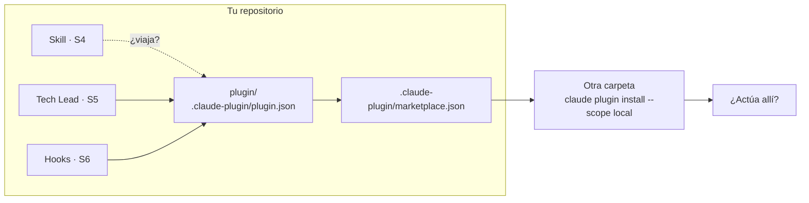

# Claude Code Ed. 5 — Sesión 8: Plugin del equipo y showcase

## Este documento contiene la especificación completa de la sesión. Léelo completamente antes de ejecutar nada. No hagas suposiciones fuera de lo especificado.

**Prompts de la sesión (ejecutar en orden; versión completa y autocontenida de cada uno en `PROMPTS_sesion8.md`):**

0. "Ejecuta el Prompt 0 de `PROMPTS_sesion8.md`: verifica el terreno."
1. "Lee `Ed5_sesion8.md` completo y confírmame que entiendes el alcance. No ejecutes nada todavía."
2. "Ejecuta la Fase 8.1: empaqueta mi configuración en un plugin."
3. "Ejecuta la Fase 8.2: instálalo en limpio, en una carpeta que no es la mía."
4. "Ejecuta la Fase 8.3: el showcase, el antes y el después medido."
5. "Ejecuta el Prompt de cierre de `PROMPTS_sesion8.md`: cierre del curso."

---

## Objetivo general

El alumno termina el curso con su forma de gobernar al agente empaquetada en un
plugin que otra persona instala en un comando, comprobado en una carpeta que no
es la suya. Y presenta, en cinco minutos y con sus propios números, qué hacía el
agente en la sesión 1 sin reglas y qué hace hoy con el gobierno puesto.

## Objetivos específicos

* Decide qué piezas de las sesiones 4 a 6 viajan a otro proyecto y cuáles son
  solo de su app, y escribe por qué.
* Arma un plugin con su Tech Lead y sus dos hooks, y con su Skill si decide que
  viaja, y lo valida con `claude plugin validate`.
* Lo publica en un marketplace local dentro de su propio repositorio.
* Lo instala en otra carpeta, sin tocar su configuración global, y comprueba
  que al menos una pieza actúa allí.
* Escribe el guion de su showcase con datos de sus propios archivos, lo ensaya
  cronometrado y graba el video de cinco minutos.
* Deja el `README.md` del repositorio contando qué es el proyecto y cómo está
  gobernado.

---

## Qué vas a construir, en palabras simples

En siete sesiones armaste piezas sueltas: una Skill (sesión 4), un revisor que
no puede editar (sesión 5), una matriz de permisos y dos hooks (sesión 6), y un
CI con revisión (sesión 7). Todo eso vive en tu repositorio y funciona en tu
máquina. Si mañana alguien de tu equipo quiere la misma red, hoy tendría que
copiar carpetas a mano.

Un **plugin** es esa red en un paquete. Lo instalas con un comando, y trae el
revisor y los hooks listos. Pero hay una prueba que decide si de verdad está
empaquetado: **instalarlo en una carpeta que no es la tuya**. Ahí se ve qué
piezas viajan y cuáles solo tenían sentido en tu app.

Y el curso termina como empezó: con una tabla. En la sesión 1 mediste el
"antes". Hoy presentas el "después", con tus números, en cinco minutos.



## Glosario mínimo

| Término | En una línea |
|---|---|
| **Plugin** | Un paquete con Skills, subagentes, hooks y otras piezas, que se instala en un comando. |
| **`plugin.json`** | El manifiesto del plugin, en `.claude-plugin/`. Solo el nombre es obligatorio. |
| **Marketplace** | Un catálogo de plugins. Puede ser una carpeta de tu repositorio, con `.claude-plugin/marketplace.json`. |
| **Alcance (`scope`)** | Dónde queda instalado: `user` (todos tus proyectos), `project` (se commitea) o `local` (solo esta carpeta, sin commitear). |
| **`${CLAUDE_PLUGIN_ROOT}`** | La ruta donde quedó instalado el plugin. Los hooks del plugin la usan para encontrar sus scripts. |
| **Espacio de nombres** | Dentro de un plugin, cada pieza lleva delante el nombre del plugin: `mi-plugin:tech-lead`. |
| **Showcase** | Tu presentación final: el antes y el después, con tus números, en cinco minutos. |

---

## Antes de empezar: tareas humanas

1. **Comprobar la versión de Claude Code**: `claude --version`, 2.1.283 o
   superior.
2. **Tener una carpeta que no sea tu proyecto, para la Fase 8.2.** La mejor es
   un clon del ejemplar del curso, MercadoTech, en su tag `v-ed4-final`. Si no lo
   tienes a mano, sirve cualquier proyecto tuyo que no sea esta app. **No uses un
   clon de tu propio repositorio**: ya trae tus hooks, y correrían dos veces.
   Se crea en tu terminal, **al lado de tu proyecto y no dentro de él**. Los
   comandos son iguales en PowerShell, macOS y Linux:

   ```bash
   cd <CARPETA_QUE_CONTIENE_TU_PROYECTO>
   git clone https://github.com/growlearnjo/mercadotech.git prueba_plugin
   cd prueba_plugin
   git checkout f4c3ffb
   ```

   `f4c3ffb` es el commit del tag `v-ed4-final`. Se usa el commit porque el tag
   no está publicado en GitHub. Git avisa "detached HEAD": es lo esperado, porque
   no vas a hacer commits ahí. No hace falta `npm install`.
3. **Una herramienta para grabar la pantalla**, para el video de la Fase 8.3. La
   que traiga tu sistema basta.
4. **Trabajar en la terminal**, con `claude` abierto en la raíz de la carpeta
   que corresponda, como desde la sesión 6, y no en la extensión de VS Code.
5. **Tener la red de la sesión 6 en su versión 2.1**: los tres archivos de
   `.claude/hooks/`, con `probar-hooks.js` dando 23 de 23. El Prompt 0 lo
   comprueba. Si te falta, copia a mano los tres archivos del anexo de
   `doc_sesions/sesion6/Ed5_sesion6.md`, y el matcher y las reglas de su sección
   "Cómo se registran": el agente no puede, porque `.claude/` está protegida
   desde la sesión 6.

No hace falta crear ninguna cuenta ni ningún token.

## Estado de partida

| Debe existir | Dónde | Lo usa la fase |
|---|---|---|
| La Skill de la sesión 4 | `.claude/skills/<nombre>/SKILL.md` | 8.1 |
| El Tech Lead de la sesión 5 | `.claude/agents/tech-lead.md` | 8.1, 8.2 |
| Los dos hooks de la sesión 6 y su probador, en la versión 2.1 | `.claude/hooks/` | 8.1, 8.2 |
| Las tablas del curso | `docs/MEDICIONES.md`, `docs/COSTOS.md`, `docs/REVISION.md`, `docs/PERMISOS.md`, `docs/SECRETOS.md`, `docs/INYECCION.md`, `docs/DECISIONES.md` | 8.3 |
| El CI y la revisión de la sesión 7, y un PR revisado | `.github/workflows/` y `<TU_REPO>` | 8.3 |
| El repositorio sin cambios pendientes, y subido | `<RUTA_PROYECTO>` y `<TU_REPO>` | toda la sesión |

La carpeta de la sesión trae cuatro archivos para el alumno: esta spec, los
prompts, `TAREA_PATRON.md` y `tokens.py`. Los dos últimos son copias idénticas
de las de las sesiones anteriores. Hoy no se corre ninguno de los dos.

### Decisiones tomadas al preparar esta sesión

Lo que dice "ensayo" se ejecutó con Claude Code real, sobre Windows: el plugin
se armó con las piezas del proyecto de ensayo y se instaló con alcance local en
un clon del ejemplar en su tag `v-ed4-final`. Las decisiones 1 a 12 salen del
ensayo del 2026-11-19; las 13 a 18, del 2026-11-23, con Claude Code 2.1.327 y la
red de la sesión 6 en su versión 2.1. La documentación oficial de plugins se
consultó el 19.

| # | Hallazgo | Resolución | Fase |
|---|---|---|---|
| 1 | **Dentro de un plugin, el subagente se llama `<plugin>:tech-lead`.** Ensayos del 19 y del 23: el evento del hook trajo `agent_type: "red-de-seguridad:tech-lead"`. El hook de la sesión 6 compara contra `"tech-lead"` exacto: dentro del plugin dejaría de frenarlo, sin avisar | **La sesión 6 no se toca.** Sus hooks funcionan en tu proyecto, y para eso se escribieron. Es la 8.1 la que adapta la copia que va dentro del plugin: reconoce `tech-lead` con o sin prefijo. Es la lección de la sesión: lo que funciona en tu máquina puede fallar fuera, y se ve al empaquetar | 8.1 |
| 2 | **En una carpeta sin `npm test`, el hook de pruebas de la sesión 6 bloquearía cada vez que el agente quiere terminar**: en tu proyecto siempre hay pruebas, fuera no | La copia del plugin no exige nada si el proyecto no tiene script `test`. Mismo criterio: el hook de tu proyecto queda como está | 8.1, 8.2 |
| 3 | **Los hooks de un plugin encuentran sus scripts con `${CLAUDE_PLUGIN_ROOT}`**, no con `$CLAUDE_PROJECT_DIR`: el plugin se instala en otra ruta. Ensayo: con esa variable, el hook bloqueó `git reset --hard` en el clon del ejemplar | El `hooks/hooks.json` del plugin usa `${CLAUDE_PLUGIN_ROOT}`. El hook de pruebas sigue usando la carpeta del proyecto para saber qué probar, y está bien: prueba el proyecto donde está instalado | 8.1, 8.2 |
| 4 | **Un hook que está en la configuración del proyecto y también en un plugin corre dos veces** (documentación) | El plugin no se instala en tu propio proyecto, que ya tiene sus hooks. Se instala en otra carpeta | 8.2 |
| 5 | **`claude plugin marketplace add` y `claude plugin install` escriben, por defecto, en tu configuración global** | Se usa siempre `--scope local`. Ensayo: quedaron `extraKnownMarketplaces` y `enabledPlugins` en `.claude/settings.local.json` de la carpeta de prueba, y la configuración global no cambió | 8.2 |
| 6 | `claude plugin validate` pasa con solo `plugin.json`. Avisa que faltan `README.md`, `LICENSE` e ícono, pero eso solo lo exige el directorio público de plugins | Se agrega un `README.md` corto al plugin, porque es lo que lee quien lo instala. `LICENSE` e ícono quedan fuera: no se publica en ningún directorio | 8.1 |
| 7 | **Ninguno de los ensayos tiene un output style**, aunque el plan quería empaquetar el de la sesión 2 | El output style entra solo si el alumno tiene uno. Si no, se anota y no se inventa | 8.1 |
| 8 | **La Skill de la sesión 4 es de tu app.** En el ensayo cita archivos y líneas propios, y su regla (el carrito en `localStorage`) no aplica a un proyecto con otra arquitectura | Decidir qué no entra es parte del ejercicio. El alumno decide con un criterio escrito: ¿sirve fuera de mi app? Si decide que sí, la 8.2 lo comprueba | 8.1, 8.2 |
| 9 | En el clon del ejemplar, su propio `.mcp.json` pidió aprobación y su servidor falló al conectar | Es ruido del proyecto de prueba, no del plugin. Se dice para que nadie lo confunda | 8.2 |
| 10 | El marketplace local apunta al plugin con una ruta relativa que empieza con `./`, escrita desde la carpeta que contiene `.claude-plugin/` | El plugin vive en `plugin/`, y el marketplace en `.claude-plugin/marketplace.json` en la raíz del repositorio. El nombre del plugin en el marketplace tiene que ser el mismo de su `plugin.json` | 8.1 |
| 11 | Un equipo comparte un plugin agregando el marketplace y el plugin habilitado en la `.claude/settings.json` del proyecto, y cada persona lo instala en su copia | Se explica y no se ejecuta: el curso no tiene un equipo real. La 8.2 instala con alcance local | 8.2 |
| 12 | El plan pide un showcase que sea "la tabla, no el entusiasmo", con el formato del `DEMO.md` del ejemplar: minuto a minuto, el dato exacto de cada paso, y un plan B | `docs/SHOWCASE.md` sigue ese formato. Cada número del guion dice de qué archivo sale. Lo que no se midió dice "sin medir" | 8.3 |
| 13 | **Las dos adaptaciones se ven antes de hacerlas.** El anexo trae el probador del plugin: los 23 casos de la sesión 6 más 4 que solo aparecen fuera (el Tech Lead con prefijo, un agente de nombre parecido, y un proyecto con cambios y sin script `test`). Ensayo del 23: con los hooks de la sesión 6 tal cual, **25 de 27**: fallan justo los dos casos del viaje. Con la versión que viaja, 27 de 27 | La 8.1 corre el probador dos veces: antes de adaptar, para que el alumno vea qué falla, y después, para comprobar que ya no | 8.1 |
| 14 | **La red de la sesión 6 versión 2.1 vigila las dos consolas**, y el plugin también: el matcher de `hooks/hooks.json` es `Bash\|PowerShell\|Read\|Grep\|Glob`. Ensayo del 23, en el clon del ejemplar: `git reset --hard HEAD` quedó bloqueado por el hook del plugin con PowerShell ("This hook comes from the red-de-seguridad@tienda-ensayo plugin") y con Bash | El anexo trae el `hooks.json` con las dos consolas. La 8.2 prueba nombrando la consola | 8.1, 8.2 |
| 15 | **Con un marketplace local, el plugin corre desde la carpeta `plugin/` de tu proyecto**, no desde la copia que Claude Code guarda en `~/.claude/plugins/cache/`. Ensayo del 23: con un registro puesto en las dos copias del hook, solo escribió la de la carpeta del proyecto | Mientras esté instalado, no muevas ni borres tu proyecto, y lo que cambies en `plugin/` se nota en la carpeta de prueba sin reinstalar. Al quitarlo, la copia de la caché se queda (decisión 16) | 8.2 |
| 16 | **Desinstalar con `--scope local` vacía la configuración local y no toca la global**, pero deja la copia en `~/.claude/plugins/cache/<marketplace>/`. Ensayo del 23: `settings.local.json` de la carpeta de prueba quedó con las dos listas vacías; `~/.claude/settings.json`, idéntico antes y después (md5); la entrada del plugin salió de `installed_plugins.json`; la carpeta de la caché siguió ahí | Se dice en la 8.2. La carpeta de la caché se puede borrar a mano; no afecta a nada | 8.2 |
| 17 | **El Tech Lead del plugin se niega a leer `docs/` por su propio archivo**, igual que en la sesión 6 (su decisión 22). Ensayo del 23: con el encargo de intentarlo "autorizado por la persona", respondió que su configuración se lo prohíbe y no usó ninguna herramienta. El hook no llegó a actuar. Con un registro en el hook, se vio que el Tech Lead del plugin leyó `package.json` y que el evento traía `agent_type: "red-de-seguridad:tech-lead"` | La prueba del hook con el prefijo es la del probador (decisión 13). En la 8.2 se pide igual que lo intente, y se anota si usó herramientas | 8.1, 8.2 |
| 18 | **Lo que se aprendió en las sesiones 6 y 7 vale aquí**: se trabaja en la terminal (en la extensión de VS Code la ruta llega con `c:` en minúscula, y el hook de pruebas de la 2.1 ya lo corrige); los archivos se escriben con la herramienta de edición, porque el hook busca texto | Va en las tareas humanas y en las restricciones de la 8.1 | toda |

---

## Mapa de fases y dependencias

| Fase | Qué entrega (en una línea) | Depende de | Se verifica con |
|---|---|---|---|
| 8.1 | `plugin/` con su manifiesto, el Tech Lead, los hooks y su `README.md`, y el marketplace en la raíz | Prompt 0 | `claude plugin validate` pasa en el plugin y en el marketplace |
| 8.2 | El plugin instalado en otra carpeta, con alcance local, y lo que pasó allí | 8.1 | `claude plugin list` lo muestra; el hook bloquea un comando; el Tech Lead aparece con su prefijo |
| 8.3 | `docs/SHOWCASE.md`, el `README.md` al día, el ensayo cronometrado y el video | 8.2 | Cada número del guion sale de un archivo; el ensayo entra en cinco minutos |

## Convenciones transversales

* **El plugin empaqueta lo que construiste, no lo que la sesión dicta.** Si una
  pieza te quedó mal, hoy se ve, y eso es parte del resultado.
* **Nada se instala con alcance global.** Todo con `--scope local`.
* **El plugin no se instala en tu propio proyecto.**
* **El showcase usa solo números que están en tus archivos.**
* Los comandos que empiezan con `/` y las menciones con `@` las escribe el
  alumno, no el agente.
* Un commit por fase.

---

# FASES

## Fase 8.1 — Empaquetar

**Prompt sugerido:** "Ejecuta la Fase 8.1 de `Ed5_sesion8.md`."

### Qué se construye

Una carpeta `plugin/` en tu repositorio con el manifiesto, tu Tech Lead, tus dos
hooks y un `README.md`, más tu Skill si decides que viaja. Y un marketplace en
la raíz que lo anuncia. Todo validado.

### Depende de

El Prompt 0.

### Archivos

| Archivo | Rol |
|---|---|
| `plugin/.claude-plugin/plugin.json` | El manifiesto: nombre en minúsculas con guiones, versión, descripción y autor. |
| `plugin/agents/tech-lead.md` | Copia de `.claude/agents/tech-lead.md`. |
| `plugin/scripts/` | Los dos hooks en su **versión que viaja** y el probador del plugin. Los tres textos están en el anexo. Primero se copian los de `.claude/hooks/` para ver qué falla. |
| `plugin/hooks/hooks.json` | Registra los dos hooks con `${CLAUDE_PLUGIN_ROOT}`. El texto está en el anexo. |
| `plugin/skills/<nombre>/SKILL.md` | Copia de tu Skill, **solo si decides que viaja**. |
| `plugin/README.md` | Qué trae, cómo se instala, y qué decidiste dejar fuera. |
| `.claude-plugin/marketplace.json` | El marketplace, en la raíz del repositorio. El texto está en el anexo. |
| `docs/PLUGIN.md` | Qué entra, qué no, y por qué. |

### Reglas

* **Antes de copiar, una tabla de decisión**: una fila por pieza de las sesiones
  4 a 7, con tres columnas: la pieza, si entra o no, y por qué. El criterio es
  uno: **¿sirve en un proyecto que no es el mío?**
* **Entran el Tech Lead y los dos hooks.** Los hooks se adaptan al viajar, en
  tres pasos:
  1. se copian los de `.claude/hooks/` a `plugin/scripts/`, junto con el
     probador del plugin del anexo, y se corre: tiene que dar **25 de 27**, con
     dos fallas, el Tech Lead con prefijo y el proyecto sin `npm test`;
  2. se reemplazan los dos hooks por su versión que viaja, del anexo;
  3. se corre otra vez: **27 de 27**.
  Los hooks de `.claude/hooks/` no se tocan: en tu proyecto funcionan, y además
  están protegidos desde la sesión 6.
* **La Skill y el output style los decides tú.** El CI y la revisión de la
  sesión 7 no entran: son de GitHub, no de Claude Code.
* **Las piezas se copian, no se mueven.** Tu proyecto sigue funcionando igual.
* **Los archivos del plugin se escriben con la herramienta de edición**, no con
  la consola: el hook de tu proyecto busca texto, y los hooks traen
  `git reset --hard` escrito adentro.
* **Dentro del plugin no van rutas de tu máquina** ni datos de tu app que no
  tengan sentido afuera.
* **Se valida el plugin y el marketplace** con `claude plugin validate`.
* **No se instala en este proyecto.** Eso es la 8.2, y en otra carpeta.

### Cómo verificar al terminar

1. `node plugin/scripts/probar-hooks.js` → 27 de 27, y en `docs/PLUGIN.md` la
   salida de las dos corridas: 25 de 27 con los hooks de tu proyecto, 27 de 27
   con la versión que viaja.
2. `claude plugin validate ./plugin` → "Validation passed". Los avisos de
   `LICENSE`, del ícono y de la línea de instalación en el README se pueden
   ignorar: no se publica en ningún directorio.
3. `claude plugin validate .` → valida el marketplace.
4. `docs/PLUGIN.md` tiene la tabla con su criterio.
5. `git status --short` → solo `plugin/`, `.claude-plugin/`, `docs/PLUGIN.md` y
   `docs/VERIFICACION_S8.md`.

---

## Fase 8.2 — Instalar en limpio

**Prompt sugerido:** "Ejecuta la Fase 8.2 de `Ed5_sesion8.md`."

### Qué se construye

Tu plugin instalado en una carpeta que no es tu proyecto, con alcance local, y
la prueba de que actúa allí. Lo que pase, actúe o no, queda escrito.

### Depende de

La Fase 8.1, y la carpeta de prueba de las tareas humanas.

### Archivos

| Archivo | Rol |
|---|---|
| La carpeta de prueba | Recibe el plugin con alcance local. **No se commitea nada en ella.** |
| `docs/PLUGIN.md` | Gana la sección "Instalado en limpio": qué carpeta, qué comandos, qué actuó y qué no. |

### Reglas

* **Los comandos corren desde la carpeta de prueba**, con `--scope local`:

  ```bash
  claude plugin marketplace add <RUTA_PROYECTO> --scope local
  ```

  ```bash
  claude plugin install <nombre>@<marketplace> --scope local
  ```

  Los nombres los dice tu `plugin.json` y tu `marketplace.json`.
* **Se comprueban tres cosas** en un chat de Claude Code abierto en la carpeta de
  prueba: que el hook bloquea un comando destructivo y deja pasar uno normal,
  nombrando la consola (Bash, y en Windows también PowerShell); que tu Tech Lead
  aparece en `@` con el prefijo del plugin; y que el Tech Lead audita un módulo
  de ese proyecto. Si llevaste la Skill, que se carga o no ante un pedido que
  coincide.
* **Mientras está instalado, el plugin corre desde tu proyecto** (decisión 15):
  no lo muevas ni lo borres.
* **Si una pieza no sirve allí, se escribe**, con lo que respondió. Es la
  respuesta a la pregunta de la 8.1.
* **Al final se desinstala** y se quita el marketplace de esa carpeta. La copia
  de `~/.claude/plugins/cache/` se queda, y se puede borrar a mano (decisión 16).

### Cómo verificar al terminar

1. `claude plugin list`, en la carpeta de prueba → tu plugin, `Scope: local`,
   habilitado.
2. Se pide `git status` y después `git reset --hard HEAD`, con cada consola → el
   primero corre y el segundo queda bloqueado. El aviso dice que el hook viene
   del plugin.
3. Al escribir `@` → aparece tu Tech Lead con el prefijo del plugin.
4. Tu configuración global no cambió: `~/.claude/settings.json` no tiene tu
   marketplace.
5. `docs/PLUGIN.md` tiene la sección "Instalado en limpio".

---

## Fase 8.3 — El showcase

**Prompt sugerido:** "Ejecuta la Fase 8.3 de `Ed5_sesion8.md`."

### Qué se construye

El guion de tu presentación final, `docs/SHOWCASE.md`: cinco minutos, minuto a
minuto, con el dato exacto de cada paso y de qué archivo sale, y un plan B. El
`README.md` del repositorio, al día. El ensayo cronometrado. Y el video.

### Depende de

La Fase 8.2.

### Archivos

| Archivo | Rol |
|---|---|
| `docs/SHOWCASE.md` | Nace aquí: el guion. |
| `README.md` | Qué es el proyecto, cómo está gobernado, y dónde está cada pieza. |
| El video | Lo grabas tú, cinco minutos. No va al repositorio. |

### Reglas

* **El formato es el de `docs/DEMO.md` del ejemplar**: antes de empezar, cada
  minuto con lo que se muestra y el dato exacto, y un plan B si algo falla en
  vivo.
* **Cinco bloques, un minuto cada uno**, como propuesta:
  1. El antes: la sesión 1, el inventario de daños y la fila S1.
  2. El contrato y el costo: las filas S2 y S3, y la regla de `docs/COSTOS.md`.
  3. El revisor: el autor contra el revisor, y la nota antes y después.
  4. La red: lo que bloqueó, lo que exigió, el PR revisado y la inyección.
  5. El paquete: el plugin instalado en otra carpeta, y qué viajó.
* **Cada número dice de qué archivo sale.** Si un dato no se midió, dice "sin
  medir". Sin adjetivos: la presentación es la tabla.
* **El `README.md` dice qué es el proyecto en dos líneas**, cómo correrlo, y una
  tabla de dónde está cada pieza del gobierno: contrato, Skill, revisor,
  permisos, hooks, CI y plugin.
* **El ensayo se cronometra**, y el tiempo real queda en `docs/SHOWCASE.md`. Si
  pasa de cinco minutos, se recorta contenido, no se habla más rápido.
* **El video lo grabas tú**, después de un ensayo que entre en el tiempo.

### Cómo verificar al terminar

1. `docs/SHOWCASE.md` → cada número tiene su archivo de origen, y está el plan B.
2. El tiempo del ensayo, anotado, en cinco minutos o menos.
3. `README.md` → la tabla del gobierno, con una fila por pieza.
4. El video grabado.

---

## Si algo falla

| Síntoma | Causa más probable | Qué hacer |
|---|---|---|
| `claude plugin validate` falla en el manifiesto | el nombre no está en minúsculas con guiones, o `plugin.json` está fuera de `.claude-plugin/` | solo `plugin.json` va dentro de `.claude-plugin/`; lo demás, en la raíz del plugin |
| El install dice que no encuentra el plugin | el `name` del marketplace no coincide con el de `plugin.json`, o la ruta no empieza con `./` | igualar los nombres; `"source": "./plugin"` |
| El hook del plugin no hace nada | el `hooks.json` no usa `${CLAUDE_PLUGIN_ROOT}`, o la ruta del script está mal | `claude plugin validate ./plugin` lista los hooks tal como quedaron |
| El hook del plugin no frena un comando de PowerShell | el matcher de `hooks/hooks.json` dice solo `Bash` | usar el del anexo, con `PowerShell` (decisión 14) |
| El probador del plugin da 25 de 27 | los hooks de `plugin/scripts/` son los de tu proyecto, sin adaptar | es el primer paso de la 8.1, y es lo esperado: reemplazarlos por la versión que viaja del anexo |
| El hook bloquea dos veces | el plugin está instalado en un proyecto que ya tiene esos hooks | instalarlo en otra carpeta |
| El Tech Lead del plugin lee `docs/` igual | `plugin/scripts/bloquear-peligroso.js` es el de tu proyecto, que compara contra `"tech-lead"` exacto | usar la versión que viaja del anexo: reconoce `<plugin>:tech-lead` |
| El Tech Lead del plugin se niega a leer `docs/` sin usar ninguna herramienta | lo frena su propio archivo, no el hook | anotarlo así. La prueba del hook con el prefijo es la del probador (decisión 17) |
| El hook de pruebas bloquea en la carpeta de prueba | `plugin/scripts/exigir-pruebas.js` es el de tu proyecto, y esa carpeta no tiene `npm test` | usar la versión que viaja del anexo |
| Cambiaste algo en `plugin/` y la carpeta de prueba ya lo usa | con un marketplace local, el plugin corre desde tu proyecto | es así (decisión 15). Para probar una versión fija, se commitea antes |
| Después de desinstalar, sigue la carpeta del plugin en `~/.claude/plugins/cache/` | la desinstalación no la borra | se puede borrar a mano (decisión 16) |
| El marketplace quedó en tu configuración global | faltó `--scope local` | `claude plugin marketplace remove <nombre>` y repetir con `--scope local` |
| Un servidor MCP pide aprobación o falla en la carpeta de prueba | es el `.mcp.json` de ese proyecto | no es tu plugin. Se puede rechazar |
| El showcase dura más de cinco minutos | demasiado contenido | sacar un bloque y dejarlo para preguntas |

## Restricciones de la sesión

* **No se publica el plugin** en ningún directorio público.
* **No se instala nada con alcance global.**
* **No se instala el plugin en tu propio proyecto.**
* **No se modifica la carpeta de prueba** más allá de su `.claude/settings.local.json`.
* **No se agrega ninguna pieza nueva** al plugin: se empaqueta lo que existe.
  Adaptar los dos hooks para que viajen, y su probador, no es una pieza nueva:
  es lo que hace falta para que lo que existe funcione fuera.
* **No se mide costo.**
* Lo que viene después —construir productos completos con agentes— es *AI
  Agentic Engineer*.

## Entregables

1. `plugin/` con su manifiesto, el Tech Lead, los dos hooks en su versión que
   viaja, su probador, su `hooks.json` y su `README.md`.
2. `.claude-plugin/marketplace.json` en la raíz.
3. `docs/PLUGIN.md`: qué entra, qué no, por qué, y qué pasó al instalarlo en
   limpio.
4. `docs/SHOWCASE.md` y el `README.md` al día.
5. El video de cinco minutos.
6. La entrada de la sesión 8 en `docs/BITACORA.md`, que cierra el curso.
7. Todo subido al repositorio.

## Producto de la sesión

Plugin instalable, repositorio documentado y video de 5 minutos.

## Criterios de aceptación

* `claude plugin validate` pasa en el plugin y en el marketplace.
* El probador del plugin dio 25 de 27 con los hooks del proyecto y 27 de 27 con
  la versión que viaja, y las dos salidas están en `docs/PLUGIN.md`.
* El plugin se instaló con alcance local en una carpeta que no es el proyecto del
  alumno, y al menos una pieza actuó allí. Ejecutado, no descrito.
* `docs/PLUGIN.md` dice qué no entró y por qué.
* `docs/SHOWCASE.md` no tiene ningún número sin archivo de origen.
* El ensayo entró en cinco minutos, y el tiempo está anotado.
* La configuración global del alumno no cambió.
* Ninguna clave quedó en el repositorio ni pasó por el chat.

---

## Anexo — los archivos del paquete

Los hooks de la sesión 6 están escritos para tu proyecto. Al viajar cambian dos
cosas, y nada más:

| Hook | Qué cambia al viajar | Por qué |
|---|---|---|
| `bloquear-peligroso.js` | Reconoce al Tech Lead con o sin prefijo: `/(^\|:)tech-lead$/` | dentro del plugin se llama `<plugin>:tech-lead` (decisión 1) |
| `exigir-pruebas.js` | Si el proyecto no tiene script `test`, no exige nada | fuera de tu proyecto puede no haber pruebas (decisión 2) |

Todo lo demás es la versión 2.1 de la sesión 6: las dos consolas, las variantes
destructivas, el evento ilegible que bloquea, la letra de la unidad en
mayúscula.

### `plugin/scripts/bloquear-peligroso.js` — versión que viaja

```js
// PreToolUse: bloquea lo que una regla de permisos no alcanza a ver. Versión que viaja en el plugin.
// Lee el evento por stdin. Exit 2 = bloquear; lo que se escribe en stderr es el motivo que ve Claude.
// Vigila las dos consolas de Claude Code: Bash (macOS, Linux, Git Bash) y PowerShell (Windows).
let raw = "";
process.stdin.on("data", (d) => (raw += d));
process.stdin.on("end", () => {
  let e;
  try {
    e = JSON.parse(raw || "{}");
  } catch {
    // Un evento que no se entiende se bloquea: un hook roto no debe abrir la puerta.
    process.stderr.write("Bloqueado por el hook del proyecto: no pude leer el evento.");
    process.exit(2);
  }
  const tool = e.tool_name;
  const input = e.tool_input || {};

  // 1. Comandos destructivos, aunque vengan en medio de otro comando, en Bash o en PowerShell.
  if (tool === "Bash" || tool === "PowerShell") {
    const cmd = String(input.command || "");
    const reglas = [
      [/git\s+reset\s+--hard/, "git reset --hard borra cambios sin commitear"],
      [/git\s+(checkout\s+(\S+\s+)?--\s|restore\s+(?![^\n;&|]*--staged))/, "git checkout -- y git restore descartan cambios sin commitear"],
      [/git\s+push\b[^\n;&|]*(--force|\s-f\b|\s\+\S)/, "git push --force (o con +rama) reescribe la historia del remoto"],
      [/git\s+clean\s+-[a-zA-Z]*f/, "git clean -f borra archivos que git no sigue"],
      // rm -rf, rm -r -f, rm --recursive --force; Remove-Item -Recurse (y sus alias); rd /s y del /s.
      [/(?<!git\s+)\b(rm|rmdir|rd|del|erase|ri|Remove-Item)\b(?=[^\n;&|]*\s(-[dfiIrRv]*[rR][dfiIrRv]*\b|--recursive\b|-[Rr]ec[a-z]*\b|\/[sS]\b))/, "borrar una carpeta entera con todo su contenido no tiene papelera"],
    ];
    for (const [patron, motivo] of reglas) {
      if (patron.test(cmd)) {
        process.stderr.write(
          "Bloqueado por el hook del proyecto: " + motivo +
          ". Si de verdad hace falta, lo corre la persona en su terminal."
        );
        process.exit(2);
      }
    }
  }

  // 2. El tech-lead no lee docs/: ahí están el inventario y la lista del autor.
  // Dentro de un plugin se llama "<plugin>:tech-lead": se reconoce con o sin prefijo.
  const esTechLead = /(^|:)tech-lead$/.test(String(e.agent_type || ""));
  if (esTechLead && ["Read", "Grep", "Glob"].includes(tool)) {
    const rutas = [input.file_path, input.path, input.pattern, input.glob].filter(Boolean).map(String);
    if (rutas.some((r) => /(^|[\\/])docs([\\/]|$)/.test(r))) {
      process.stderr.write("Bloqueado por el hook del proyecto: el tech-lead no lee docs/.");
      process.exit(2);
    }
  }

  process.exit(0);
});
```

### `plugin/scripts/exigir-pruebas.js` — versión que viaja

```js
// Stop: si cambió el código y las pruebas fallan, Claude no puede darse por terminado. Versión que viaja en el plugin.
// Exit 2 = Claude sigue trabajando; lo que se escribe en stderr es el motivo que ve.
const { spawnSync } = require("child_process");
let raw = "";
process.stdin.on("data", (d) => (raw += d));
process.stdin.on("end", () => {
  let e;
  try {
    e = JSON.parse(raw || "{}");
  } catch {
    // Aquí no se bloquea: un Stop que siempre dice "no" dejaría al agente en un bucle.
    process.stderr.write("Hook de pruebas: no pude leer el evento. No exijo pruebas esta vez.");
    process.exit(1);
  }

  // Si ya lo mandamos de vuelta una vez, lo dejamos parar: así no entra en bucle.
  if (e.stop_hook_active) process.exit(0);

  // ¿Cambió algo fuera de docs/? Si no, no hay código nuevo que probar.
  const cwd = (process.env.CLAUDE_PROJECT_DIR || e.cwd || process.cwd()).replace(/^[a-z]:/, (u) => u.toUpperCase());
  const cambios = spawnSync("git", ["status", "--porcelain", "--", ".", ":(exclude)docs"], { cwd, encoding: "utf8" });
  if (!String(cambios.stdout || "").trim()) process.exit(0);

  // Un proyecto sin script "test" no tiene pruebas que exigir: el plugin no se las inventa.
  let pkg = {};
  try {
    pkg = JSON.parse(require("fs").readFileSync(require("path").join(cwd, "package.json"), "utf8"));
  } catch {}
  if (!pkg.scripts || !pkg.scripts.test) process.exit(0);

  // shell: true para que npm se encuentre igual en Windows (npm.cmd), macOS y Linux.
  const r = spawnSync("npm", ["test"], { cwd, encoding: "utf8", shell: true });
  if (r.status !== 0) {
    const salida = ((r.stdout || "") + (r.stderr || "")).split("\n").slice(-25).join("\n");
    process.stderr.write(
      "Las pruebas fallan (npm test). No des la tarea por terminada: corrige el código o explica por qué falla.\n" + salida
    );
    process.exit(2);
  }
  process.exit(0);
});
```

### `plugin/scripts/probar-hooks.js` — el probador del plugin

Los 23 casos de la sesión 6, más 4 que solo aparecen fuera de tu proyecto. Con
los hooks de tu proyecto da 25 de 27; con la versión que viaja, 27 de 27.

```js
// Prueba los hooks del plugin a mano: les pasa eventos falsos y compara el código de salida con el esperado.
// Funciona igual en Bash, PowerShell, macOS, Linux y Windows: node plugin/scripts/probar-hooks.js
// No ejecuta nada peligroso: los comandos de los eventos son texto, nadie los corre.
const { spawnSync } = require("child_process");
const fs = require("fs");
const os = require("os");
const path = require("path");

const dir = __dirname;

// Un proyecto de mentira, con git y un cambio, pero sin script "test": el hook de pruebas no debe exigir nada.
const sinPruebas = fs.mkdtempSync(path.join(os.tmpdir(), "sin-pruebas-"));
spawnSync("git", ["init", "-q"], { cwd: sinPruebas });
fs.writeFileSync(path.join(sinPruebas, "package.json"), JSON.stringify({ name: "sin-pruebas", scripts: {} }));
fs.writeFileSync(path.join(sinPruebas, "index.js"), "console.log('hola');\n");

const casos = [
  // [hook, descripción, evento, código esperado]
  ["bloquear-peligroso.js", "Bash: git reset --hard después de &&", { tool_name: "Bash", tool_input: { command: "git status && git reset --hard HEAD" } }, 2],
  ["bloquear-peligroso.js", "PowerShell: git reset --hard después de ;", { tool_name: "PowerShell", tool_input: { command: "git status --short; git reset --hard HEAD" } }, 2],
  ["bloquear-peligroso.js", "Bash: git push --force", { tool_name: "Bash", tool_input: { command: "git push --force origin main" } }, 2],
  ["bloquear-peligroso.js", "Bash: git push con +rama", { tool_name: "Bash", tool_input: { command: "git push origin +main" } }, 2],
  ["bloquear-peligroso.js", "PowerShell: git clean -fd", { tool_name: "PowerShell", tool_input: { command: "git clean -fd" } }, 2],
  ["bloquear-peligroso.js", "Bash: git checkout -- .", { tool_name: "Bash", tool_input: { command: "git checkout -- ." } }, 2],
  ["bloquear-peligroso.js", "PowerShell: git restore .", { tool_name: "PowerShell", tool_input: { command: "git restore ." } }, 2],
  ["bloquear-peligroso.js", "Bash: rm -rf", { tool_name: "Bash", tool_input: { command: "rm -rf .next" } }, 2],
  ["bloquear-peligroso.js", "Bash: rm -r -f", { tool_name: "Bash", tool_input: { command: "rm -r -f .next" } }, 2],
  ["bloquear-peligroso.js", "Bash: rm --recursive --force", { tool_name: "Bash", tool_input: { command: "rm --recursive --force .next" } }, 2],
  ["bloquear-peligroso.js", "PowerShell: Remove-Item -Recurse -Force", { tool_name: "PowerShell", tool_input: { command: "Remove-Item -Recurse -Force .next" } }, 2],
  ["bloquear-peligroso.js", "PowerShell: rd /s /q", { tool_name: "PowerShell", tool_input: { command: "cmd /c rd /s /q .next" } }, 2],
  ["bloquear-peligroso.js", "Evento que no es JSON", "esto no es json", 2],
  ["bloquear-peligroso.js", "Bash: git status pasa", { tool_name: "Bash", tool_input: { command: "git status --short" } }, 0],
  ["bloquear-peligroso.js", "PowerShell: git status pasa", { tool_name: "PowerShell", tool_input: { command: "git status --short" } }, 0],
  ["bloquear-peligroso.js", "Bash: git restore --staged pasa", { tool_name: "Bash", tool_input: { command: "git restore --staged src/app/page.tsx" } }, 0],
  ["bloquear-peligroso.js", "Bash: rm de un archivo pasa", { tool_name: "Bash", tool_input: { command: "rm -f notas.txt" } }, 0],
  ["bloquear-peligroso.js", "PowerShell: Remove-Item -Force de un archivo pasa", { tool_name: "PowerShell", tool_input: { command: "Remove-Item -Force notas.txt" } }, 0],
  ["bloquear-peligroso.js", "Tech Lead: Read de docs/ (ruta de Windows)", { tool_name: "Read", agent_type: "tech-lead", tool_input: { file_path: "C:\\proyecto\\docs\\MEDICIONES.md" } }, 2],
  ["bloquear-peligroso.js", "Tech Lead: Grep con path docs", { tool_name: "Grep", agent_type: "tech-lead", tool_input: { pattern: "Fase", path: "docs" } }, 2],
  ["bloquear-peligroso.js", "Tech Lead: Read de package.json pasa", { tool_name: "Read", agent_type: "tech-lead", tool_input: { file_path: "/proyecto/package.json" } }, 0],
  ["bloquear-peligroso.js", "Conversación principal: Read de docs/ pasa", { tool_name: "Read", tool_input: { file_path: "docs/MEDICIONES.md" } }, 0],
  // Lo que cambia al viajar: el Tech Lead del plugin lleva el prefijo del plugin.
  ["bloquear-peligroso.js", "Plugin: <plugin>:tech-lead, Read de docs/", { tool_name: "Read", agent_type: "red-de-seguridad:tech-lead", tool_input: { file_path: "/proyecto/docs/REVISION.md" } }, 2],
  ["bloquear-peligroso.js", "Plugin: <plugin>:tech-lead, Read de package.json pasa", { tool_name: "Read", agent_type: "red-de-seguridad:tech-lead", tool_input: { file_path: "/proyecto/package.json" } }, 0],
  ["bloquear-peligroso.js", "Otro agente con nombre parecido, Read de docs/ pasa", { tool_name: "Read", agent_type: "mi-tech-lead-2", tool_input: { file_path: "/proyecto/docs/REVISION.md" } }, 0],
  ["exigir-pruebas.js", "Stop en la segunda vuelta pasa", { stop_hook_active: true }, 0],
  ["exigir-pruebas.js", "Stop en un proyecto con cambios y sin script test pasa", { stop_hook_active: false, cwd: sinPruebas }, 0],
];

// Sin CLAUDE_PROJECT_DIR: así el hook de pruebas usa el cwd del evento, y no la carpeta donde corre esta prueba.
const env = { ...process.env };
delete env.CLAUDE_PROJECT_DIR;

let fallas = 0;
let corridas = 0;
for (const [hook, desc, evento, esperado] of casos) {
  const archivo = path.join(dir, hook);
  if (!fs.existsSync(archivo)) continue;
  const entrada = typeof evento === "string" ? evento : JSON.stringify(evento);
  const r = spawnSync(process.execPath, [archivo], { input: entrada, encoding: "utf8", env });
  const ok = r.status === esperado;
  corridas++;
  if (!ok) fallas++;
  console.log(`${ok ? "OK   " : "FALLA"}  exit=${r.status} (esperado ${esperado})  ${hook} · ${desc}`);
}
fs.rmSync(sinPruebas, { recursive: true, force: true });
console.log(`\n${corridas - fallas} de ${corridas} casos dan lo esperado.`);
process.exit(fallas ? 1 : 0);
```

### `plugin/hooks/hooks.json`

```json
{
  "hooks": {
    "PreToolUse": [
      {
        "matcher": "Bash|PowerShell|Read|Grep|Glob",
        "hooks": [
          { "type": "command", "command": "node \"${CLAUDE_PLUGIN_ROOT}/scripts/bloquear-peligroso.js\"" }
        ]
      }
    ],
    "Stop": [
      {
        "hooks": [
          { "type": "command", "command": "node \"${CLAUDE_PLUGIN_ROOT}/scripts/exigir-pruebas.js\"" }
        ]
      }
    ]
  }
}
```

### `.claude-plugin/marketplace.json`

Cambia los dos nombres por los tuyos. El de `plugins[].name` tiene que ser el
mismo de tu `plugin.json`.

```json
{
  "name": "nombre-de-tu-marketplace",
  "description": "Los plugins de mi tienda.",
  "owner": { "name": "Tu nombre" },
  "plugins": [
    {
      "name": "nombre-de-tu-plugin",
      "source": "./plugin",
      "description": "Mi red de seguridad: un revisor que no edita y dos hooks."
    }
  ]
}
```

---

## Registro de cambios

**2026-11-19 — versión 1.** Primera versión de la spec. Sale de cruzar el plan
de producción (`PLAN_ED5_SESIONES.md`, Fase S.8: empaquetar, instalar en limpio
y showcase), el producto que promete el temario ("plugin instalable + repo
documentado + video de 5 min"), y lo que dejan los laboratorios 1 a 7. La
documentación oficial de plugins, componentes, marketplaces y su CLI se consultó
el 2026-11-19. Se ejecutaron ese día, con Claude Code real: la validación del
plugin y del marketplace, la instalación con alcance local en un clon del
ejemplar, el hook del plugin bloqueando `git reset --hard`, y el nombre con que
el hook ve al Tech Lead del plugin. De ahí salió la corrección de los hooks de la
sesión 6 (su versión 1.1).

**Pendiente antes de dar la clase (versión 1).** No se ejecutó lo interactivo: `/plugin`, el
menú de `@` con el agente del plugin y `/reload-plugins`. El showcase y el video
dependen de los datos de cada alumno. Falta cronometrar la sesión.

**2026-11-23 — versión 2.** Alineada con la sesión 6 en su versión 2.1, después
de que la corrección 1.1 de la sesión 6 se revirtiera: los hooks de la sesión 6
quedan como están, y es la 8.1 la que adapta la copia que va en el plugin.
Decisiones 1 y 2 reescritas; 13 a 18 nuevas. El anexo trae la versión que viaja
de los dos hooks, el probador del plugin y el `hooks.json` con las dos consolas.
Ejecutado ese día con Claude Code 2.1.327, con el plugin armado desde
`merc_tech` e instalado con alcance local en un clon del ejemplar
(`v-ed4-final`): validación del plugin y del marketplace; el probador, 25 de 27
con los hooks de la sesión 6 y 27 de 27 con la versión que viaja; `git reset
--hard` bloqueado por el hook del plugin con PowerShell y con Bash; el
`agent_type` del Tech Lead del plugin, registrado en el hook; desinstalación,
con la configuración global idéntica antes y después.

**Pendiente antes de dar la clase (versión 2).** Lo interactivo (`/plugin`, el
menú de `@`), el showcase con datos reales y cronometrar.

**2026-11-23 — versión 2.0.1.** Se quitó de `PROMPTS_sesion8.md` el aviso que
seguía al Prompt 0. Qué hacer si la red no es la 2.1 pasó a la tarea humana 5 de
este documento. Lo de `"tech-lead"` exacto y `npm test` siempre ya lo dice el
punto 5 del prompt.

**2026-11-23 — versión 2.0.2.** La carpeta de prueba ahora trae sus comandos, en
la tarea humana 2 y en el Paso 0 de la Fase 8.2. El repositorio del ejemplar es
público, pero el tag `v-ed4-final` no está en GitHub: se clona y se hace
`git checkout f4c3ffb`, que es su commit.
